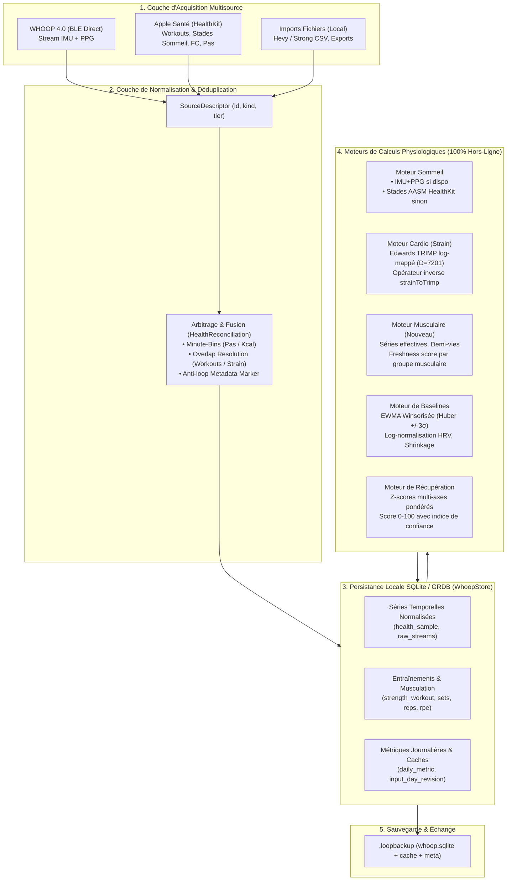
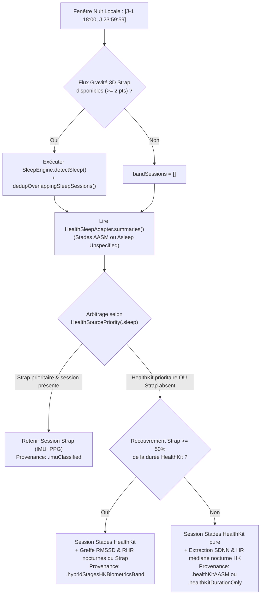

> **Note corrective — 15 novembre 2026 (revue du code et du diff en cours).** Cette note distingue les faits vérifiés des propositions à valider ; les passages du rapport ci-dessous sont conservés intégralement et peuvent la contredire.
>
> **Faits vérifiés :** le dénominateur actuel du strain est **D = 5000**, et non 7201 (`Packages/LoopStrapEngine/Sources/LoopStrapEngine/Daily/Strain.swift`). Des tests de synchronisation et de coordination BLE existent déjà dans `LoopTests/BackgroundSyncTests.swift` ; leur présence ne démontre pas à elle seule le comportement sur iPhone réel. Le diff de sécurité examiné restreignait la purge aux lignes de l’identifiant temporaire `my-whoop`, le protégeait lorsqu’il était actif et conservait les autres identifiants ; la purge en contexte multisource est désormais **en cours de suppression ou de neutralisation** et ne constitue pas un nettoyage automatique des sources. L’analyse HealthKit relève un regroupement trop grossier des producteurs dans `HealthSourceSeries.grouped`, avec un risque de double comptage ; les données cumulées disposent déjà d’un arbitrage horaire et le moteur utilise déjà des données de fréquence cardiaque Santé. `HealthContinuedSync` est déclaré dans `HealthBackgroundSync.swift`.
>
> **Propositions à valider :** l’adoption de **D = 7201** n’est pas validée ; le modèle de fatigue proposé reste spéculatif et exige une validation individuelle avec une incertitude documentée. Les performances annoncées ne sont pas établies sans mesures reproductibles (appareil, données, protocole et résultats). Les contradictions entre cette note, les constats du rapport et les prescriptions de son addendum nécessitent une revue avant toute exécution de la feuille de route ou modification du moteur. Aucun test ni build n’a été exécuté pour cette correction documentaire.

# Recherche Technique Approfondie : Évolution de Loop vers un Moteur Multisource & Sport

**Date d'analyse :** 15 novembre 2026  
**Auteur :** Antigravity Engine Architecture Team  
**Statut du document :** Rapport d'orientation technique & d'architecture  
**Dépôt cible :** `Loop` (iOS 17+, Swift / SwiftUI / GRDB / SQLite)

---

## Table des Matières

1. [Synthèse des Principales Découvertes](#1-synthèse-des-principales-découvertes)
2. [Carte Concise de l'Architecture Actuelle de Loop](#2-carte-concise-de-larchitecture-actuelle-de-loop)
3. [Tableau Comparatif des Projets Étudiés](#3-tableau-comparatif-des-projets-étudiés)
4. [Principales Limites Actuelles de Loop pour Devenir Multisource](#4-principales-limites-actuelles-de-loop-pour-devenir-multisource)
5. [Cartographie des Opportunités par Domaine](#5-cartographie-des-opportunités-par-domaine)
   - 5.1 Architecture & Modèles de Données
   - 5.2 Apple Santé / HealthKit & Applications Tierces
   - 5.3 Traçabilité, Provenance, Dédoublonnage & Qualité
   - 5.4 Moteur Physiologique & Calculs
   - 5.5 Entraînement & Musculation (Type Hevy / Strong)
   - 5.6 Stockage, Performance & Fiabilité Locale
   - 5.7 Tests & Validation
6. [Proposition d'Architecture Cible pour Loop](#6-proposition-darchitecture-cible-pour-loop)
7. [Liste Priorisée des Travaux & Évaluation](#7-liste-priorisée-des-travaux--évaluation)
8. [Découpage en Jalons Cohérents (Roadmap)](#8-découpage-en-jalons-cohérents-roadmap)
9. [Questions Ouvertes, Points à Mesurer & Tests sur iPhone Réel](#9-questions-ouvertes-points-à-mesurer--tests-sur-iphone-réel)
10. [Branches et Commits Examinés](#10-branches-et-commits-examinés)
11. [Addendum d'Ingénierie (Phase 2) : Spécifications Techniques de Niveau Implémentation](#11-addendum-dingénierie-phase-2--spécifications-techniques-de-niveau-implémentation)
    - 11.1 Axe A — Déverrouillage Architectural de `WhoopStore` et `LocalMetricsEngine`
    - 11.2 Axe B — Moteur Physiologique : Formules, Cas Limites & Preuves Mathématiques
    - 11.3 Axe C — Moteur Musculaire & Entraînement (DDL SQLite, GRDB, `MuscleRecoveryEngine`, CSV)
    - 11.4 Axe D — Apple Santé : Étanchéité Anti-Boucle, Pagination Mémoire & iOS 18 `workoutEffortScore`
    - 11.5 Axe E — Couche BLE : Protocole `BLETransportProtocol`, Multi-Profil GATT & `MockBLETransport`
    - 11.6 Réponses d'Ingénierie et Protocole de Profilage pour le Jalon 9 (iPhone Physique)

---

## 1. Synthèse des Principales Découvertes

L'audit approfondi du code de Loop et de 8 projets open-source de référence (4 en santé/récupération, 4 en entraînement/musculation) met en lumière plusieurs constats majeurs :

1. **Loop possède déjà les embryons d'un moteur multisource sophistiqué** :
   Contrairement à une idée reçue, Loop n'est plus un simple récepteur Bluetooth mono-appareil. Le code actuel dispose déjà :
   - d'un import incrémental robuste par ancres (`HKAnchoredObjectQuery`) pour 11 types d'échantillons Santé (`HealthSampleSyncEngine.swift`) et pour les entraînements (`HealthKitImporter.swift`),
   - d'un mécanisme de réconciliation pur (`HealthReconciliation.swift`) capable d'arbitrer les priorités par contexte (`.sleep`, `.rest`, `.activity`), de fusionner les séances de sport avec détection de chevauchement, et de calculer des indices d'accord entre sources,
   - d'une séparation stricte des baselines physiologiques (ex: la baseline VFC/SDNN issue d'une Apple Watch n'est jamais mélangée avec la baseline RMSSD du bracelet, testé dans `MultiSourceRecoveryTests.swift`).
2. **Le verrouillage mono-appareil de Loop se situe dans son stockage et son orchestrateur** :
   Le véritable blocage n'est pas conceptuel mais physique :
   - Les clés primaires SQLite composites dans `WhoopStore` imposent `(deviceId, ts)` ou `(deviceId, day)`.
   - L'identifiant `deviceId` est fixé à une constante locale (`"theo-whoop"` via `LocalDeviceID.swift`).
   - La méthode de nettoyage `deleteOrphanRows` supprime aveuglément toutes les lignes dont le `deviceId` diffère du strap courant, interdisant la coexistence de plusieurs périphériques.
   - L'acteur `LocalMetricsEngine` charge les flux en filtrant exclusivement sur `self.deviceId`.
3. **Les projets de santé externes apportent des solutions mathématiques éprouvées** :
   - **Cénit** démontre la formule fermée exacte pour la charge cardiovasculaire logarithmique (0–21) : $\text{Strain} = 21 \cdot \frac{\ln(\text{TRIMP} + 1)}{\ln(7201)}$, avec son inverse analytique `strainToTrimp` permettant d'additionner des charges multiples (disjointes vs chevauchantes) avant recompression. Il prouve aussi la robustesse d'une moyenne mobile exponentielle Winsorisée (Huber) avec seuils à $\pm 3\sigma$ pour les baselines.
   - **openFitness** fournit l'algorithme "Union of Activity Fusion" découpant la journée en 1440 bins d'une minute pour fusionner pas et calories du téléphone et d'un wearable sans doublon.
   - **Whoordan** démontre l'importance d'une étanchéité stricte lors de l'écriture dans Apple Santé (marquage des échantillons par métadonnées privées et politiques d'exclusion) pour éviter les boucles infinies de réimportation.
   - **Soma** apporte une modélisation pragmatique de la récupération par z-scores log-normaux de l'HRV et une gestion par fenêtres glissantes décalées (20h veille à 20h jour J) évitant les erreurs de minuit.
4. **Les projets de musculation (Ischys, openGym, UpLift, Iron) fournissent un schéma relationnel direct pour Loop** :
   - **Ischys** implémente en SQLite local un schéma d'entraînement ultra-complet (`workouts`, `workout_exercises`, `workout_sets`, `personal_records`) stockant le **RPE comme vérité terrain** en base (grille de 0.5) et calculant le RIR dynamiquement ($\text{RIR} = 10 - \text{RPE}$).
   - **openGym** formalise un modèle de fatigue musculaire exceptionnel (demi-vies de récupération par groupe musculaire : 48h jambes, 30h dos/torse, 24h bras/épaules ; ratio de charge aiguë/chronique ACWR et saturation en $1 - e^{-x}$), directement transposable en Swift pur.
   - **UpLift** montre comment exploiter les APIs iOS 18 de score d'effort (`HKQuantityType(.workoutEffortScore)`) et met en œuvre l'estimation 1RM Epley avec garde-fous stricts.
   - **openGym & Ischys** fournissent des parseurs CSV universels (supportant Hevy et Strong) capables de détecter automatiquement les délimiteurs (`,` ou `;`) et les unités (`kg` ou `lbs`).

---

## 2. Carte Concise de l'Architecture Actuelle de Loop

```
┌────────────────────────────────────────────────────────────────────────┐
│                        Loop Application (SwiftUI)                      │
│      [TodayView]            [ProfileView]            [DeviceView]      │
│           │                       │                       │            │
│           └───────────────────────┼───────────────────────┘            │
│                                   ▼                                    │
│                       LoopDataRepository (@MainActor)                  │
│                                   │                                    │
│                   ┌───────────────┴───────────────┐                    │
│                   ▼                               ▼                    │
│          LocalDataStore (actor)         LocalMetricsEngine (actor)     │
│           (cache.json atomic)            (DailyEngine, Baselines)      │
│                                                   │                    │
│                                                   ▼                    │
│                                           WhoopStore (GRDB)            │
│                                        (<AppSupport>/whoop.sqlite)     │
│                                                   ▲                    │
│                   ┌───────────────────────────────┼─────────────┐      │
│                   │                               │             │      │
│           [Pipeline BLE Band]             [HealthKit Ingest]    │      │
│          BLEConnectionManager             HealthSampleSyncEngine│      │
│                   │                       HealthKitImporter     │      │
│        BLEOffloadCoordinator                      │             │      │
│                   │                       HealthReconciliation  │      │
│       ┌───────────┴───────────┐                   │             │      │
│       ▼                       ▼                   ▼             │      │
│  Collector (Live)      Backfiller (Offload)   Tables SQL :      │      │
│  type 40/43 (25 Hz)    type 47 (chunks)     • health_sample     │      │
│       │                       │             • external_workout  │      │
│       ▼                       ▼             • workout_detail_*  │      │
│  Tables SQL :         Tables SQL :                              │      │
│  • hrSample           • hrSample                                │      │
│  • rrInterval         • rrInterval                              │      │
│  • gravitySample      • rawBatch                                │      │
│  • resp/spo2/temp     • cursors                                 │      │
│                                                                        │
│  [Sauvegarde Manuelle]                                                 │
│  BackupCoordinator ──> .loopbackup (whoop.sqlite + cache.json + meta)  │
└────────────────────────────────────────────────────────────────────────┘
```

### Principaux modules et rôles réels :
- **`Packages/WhoopProtocol`** : Décodeur bas niveau binaire du protocole propriétaire WHOOP 4.0 (`whoop_protocol.json`, `Framing.swift`, `Reassembler`, `Streams.swift`). Purement matériel.
- **`Packages/WhoopStore`** : Couche d'accès SQLite via GRDB 6+. Gère 13 migrations de schéma (`Database.swift`), des triggers de révision journalière (`input_day_revision`), le stockage des trames brutes (`rawBatch`), des streams décodés, et depuis les versions v9-v13, des entités externes (`external_workout`, `health_sample`, `workout_perceived_effort`, `workout_route_point`).
- **`Packages/LoopStrapEngine`** : Moteur de calcul physiologique pur (sans I/O, sans GRDB). Contient :
  - `SleepEngine.swift` : Détection du sommeil par accélérométrie (`streams.gravity.count >= 2`) et classification des stades AASM par époques de 30 secondes.
  - `Recovery.swift` : Z-scores composites standardisés (HRV, RHR, sommeil, respiration) avec compression logistique 0–100.
  - `Strain.swift` : Réserve cardiaque de Karvonen et accumulateur Edwards TRIMP logarithmique 0–21.
  - `Baselines.swift` : Baselines glissantes EWMA (moyenne et dispersion) avec seuils de maturité (calibrating, provisional, trusted).
- **`Loop/Core/Health/`** :
  - `HealthKitImporter.swift` : Import incrémental des `HKWorkout` via `HKAnchoredObjectQuery` avec gestion des suppressions.
  - `HealthSampleImporter.swift` (`HealthSampleSyncEngine`) : Import incrémental paginé (lots de 5 000) pour 11 types de grandeurs Santé.
  - `HealthBackgroundSync.swift` : Observers `HKObserverQuery` + `enableBackgroundDelivery` pour réveil en tâche de fond.
  - `HealthContinuedSync.swift` : Poursuite de la synchronisation au verrouillage de l'écran via `BGContinuedProcessingTask` (iOS 17+).
  - `HealthReconciliation.swift` : Arbitrage pur des sources (`.whoop`, `.appleWatch`, `.healthKit`) selon le contexte (`.sleep`, `.rest`, `.activity`), fusion des séances chevauchantes et comparaison des métriques.
- **`Loop/Core/Backup/`** :
  - `BackupCoordinator.swift` : Export et import d'une archive package `.loopbackup` via l'API en ligne `sqlite3_backup_*` (instantané cohérent sans arrêter les écritures) + `cache.json` + `meta.json`. 100% hors-ligne via `UIDocumentPickerViewController`.

---

## 3. Tableau Comparatif des Projets Étudiés

| Projet | Stack / Langage | Moteur de Données | Gestion Multisource / Provenance | Modèle Sommeil | Modèle Récupération (Recovery) | Modèle Charge (Strain / Workload) | Entraînement / Musculation | Statut Hors-ligne & Tests |
| :--- | :--- | :--- | :--- | :--- | :--- | :--- | :--- | :--- |
| **Loop** *(actuel)* | Swift 5.9+, SwiftUI | SQLite (GRDB 6+) | Tables distinctes (`hrSample` vs `health_sample`), réconciliation par contexte | Sommeil par IMU+PPG strap (`SleepEngine`) ou fallback Santé | Z-scores pondérés logistiques (HRV 50%, RHR 25%, Sommeil 15%, Resp 10%) | Edwards TRIMP sur Karvonen log-mappé 0–21 ($D=7201$) | `external_workout` (HealthKit) + RPE manuel (`workout_perceived_effort`) | 100% hors-ligne local. Tests complets sur calculs & store, 0 test sur BLE. |
| **whoordan** | Swift 5.9+, TypeScript, SQL | SQLite local (CoreData-like custom) + Supabase | `DataSource` typé, `dedupeID`, `deviceFirstRank` hiérarchique | Heuristique prédictive (PPG + Gyro + priors circadiens) | Moyenne pondérée multi-signaux, exclusion $\text{SpO}_2$ | Formule exponentielle saturante ($1 - e^{-\text{Load}/180}$) | Aucun modèle de musculation spécifique | 100% hors-ligne local possible. 13 suites de tests unitaires Swift. |
| **openFitness** | Swift 5.9+ (iOS 17), SwiftData | SwiftData (SQLite) | Distinction `isWearableSource`, fusion des pas/calories en 1440 bins d'1 min | Mapping passif des catégories HealthKit (`HKCategoryValueSleepAnalysis`) | Log-transformée HRV + Z-score centré sur $[-2.2, +2.2]$ projeté sur 0–100 | eTRIMP exponentiel uniquement sur les `HKWorkout` (0 charge de repos) | Lecture seule des entraînements HealthKit | 100% hors-ligne local. **0 test unitaire** dans le dépôt. |
| **Cénit** *(branche iOS)* | Swift 5.9+ (iOS 17), SPM | SQLite (GRDB) | Tables SQL séparées par source, `MetricArbitrationPolicy`, `SourceFusion` | Nuit rattachée au jour de réveil, fusion de sessions concurrentes | Abandon du score unique : Z-scores Winsorisés par métrique | Edwards TRIMP log-mappé 0–21 ($D=7201$), fonction inverse `strainToTrimp` | Modèle de force complet avec suivi barbel/haltère | 100% hors-ligne local. **>60 suites de tests** exhaustifs. |
| **Soma** | Swift 5.9+ (iOS 17), HealthKit | UserDefaults JSON (`DailyMetrics`) | Lecture directe HealthKit sans cache brut | Regroupement avec gap max 4h, détection sieste (10h-20h) | Z-score log-normal HRV + RHR + Sommeil + Pénalité ACR | Edwards TRIMP avec gap-capping d'1 min sur les lectures espacées | Suivi d'intervalles d'entraînement | 100% hors-ligne local. 13 suites de tests unitaires ciblées. |
| **Iron** | Swift (SwiftUI + UIKit) | CoreData (SQLite managé) | Monosource (saisie manuelle + Apple Watch live) | Aucun (hors périmètre) | Aucun (hors périmètre) | Aucun modèle de fatigue physiologique | Modèle relationnel complet, RPE 7-10 (stride 0.5), Everkinetic | 100% hors-ligne local, export `.ironbackup`. Tests unitaires complets. |
| **UpLift** | Swift 6 (iOS 17/18), SwiftData | SwiftData (`@Model`) | Monosource locale + HealthKit bi-directionnel | Aucun (hors périmètre) | Aucun (hors périmètre) | Aucun modèle cardio global | Modèle SwiftData moderne, E1RM Epley, surcharge progressive | 100% hors-ligne local. Tests unitaires et simulateur `ProgressionLab`. |
| **Ischys** | TypeScript (React Native / Hermes) | SQLite natif (Drizzle ORM) | Rédacteur différencié (`Writer.phone` vs `.watch`), remplacement sans écrasement | Aucun (hors périmètre) | Aucun (hors périmètre) | Aucun modèle cardio global | Schéma SQL relationnel exemplaire, RPE canonique, E1RM $\le 10$ reps | 100% hors-ligne local, zéro serveur. 102 suites de tests unitaires. |
| **openGym** | JavaScript (React + Capacitor) | localStorage + JSON locaux | Échange multisource avec Garmin et Apple Health via plugins natifs | Import passif de sommeil depuis HealthKit | Modèle de fraîcheur musculaire par séries effectives et demi-vies | Import des séances cardio externes pour impacter la récupération | 7 formules 1RM + Ensemble pondéré, import Hevy (API & CSV) et Strong | 100% hors-ligne local. Plusieurs centaines de tests unitaires. |

---

## 4. Principales Limites Actuelles de Loop pour Devenir Multisource

Pour évoluer vers un moteur capable d'agréger indifféremment un bracelet WHOOP, une Apple Watch, une bague connectée, des ceintures cardio BLE ou des imports Hevy, Loop rencontre 5 limitations structurelles fondamentales :

### Limite 1 : Clés primaires rigides et suppression d'orphelins dans `WhoopStore`
- **Fichiers :** `Packages/WhoopStore/Sources/WhoopStore/Database.swift`, `Reads.swift:173`.
- **Preuve dans le code :**
  Les tables de séries (`hrSample`, `rrInterval`, `gravitySample`, `battery`, etc.) ont pour clé primaire `[deviceId, ts]`. La méthode `deleteOrphanRows(keepDeviceId:)` exécute :
  ```sql
  DELETE FROM hrSample WHERE deviceId != ?;
  ```
- **Conséquence :** Si Loop ingère des données d'un second appareil BLE ou d'une source tierce portant un autre identifiant, un appel de maintenance détruit l'intégralité des données de l'autre source.

### Limite 2 : `LocalMetricsEngine` cloisonné sur un seul identifiant
- **Fichiers :** `Loop/Core/Engine/LocalMetricsEngine.swift:85-115`.
- **Preuve dans le code :**
  `LocalMetricsEngine` est initialisé avec `nonisolated let deviceId: String`. Toutes ses lectures de signaux bruts (`store.hrSamples(deviceId: self.deviceId, ...)`) filtrent strictement sur ce `deviceId`.
- **Conséquence :** Les échantillons de fréquence cardiaque enregistrés dans `health_sample` (provenant d'une Apple Watch ou d'un autre capteur) ne sont pas lus comme signal primaire, mais seulement raccordés en post-traitement partiel dans `Daily.swift:mergeSupplementalHR`.

### Limite 3 : Le détecteur de sommeil exige de l'accélérométrie brute haute fréquence
- **Fichiers :** `Packages/LoopStrapEngine/Sources/LoopStrapEngine/Sleep/SleepEngine.swift:34-45`.
- **Preuve dans le code :**
  ```swift
  guard streams.gravity.count >= 2 else { return [] }
  ```
- **Conséquence :** `SleepEngine` ne peut analyser le sommeil que si le périphérique transmet des deltas de gravité 3D continus (caractéristique spécifique au WHOOP 4.0). Si l'utilisateur dort avec une Apple Watch, une bague Oura ou une montre Garmin qui n'exporte vers HealthKit que des stades AASM pré-segmentés, le moteur `SleepEngine` échoue. Le relais doit être assuré par un adaptateur dédié (`HealthSleepAdapter`), ce qui est fonctionnel mais crée deux architectures parallèles non unifiées.

### Limite 4 : Absence de modèle relationnel pour les exercices et séries de musculation
- **Fichiers :** `Packages/WhoopStore/Sources/WhoopStore/Database.swift:166-260`.
- **Preuve dans le code :**
  Loop gère les séances de sport via `external_workout` (v9) et y associe un RPE journalier via `workout_perceived_effort` (v12) :
  ```sql
  CREATE TABLE workout_perceived_effort (
      workoutId TEXT PRIMARY KEY,
      rpe INTEGER NOT NULL CHECK (rpe >= 1 AND rpe <= 10),
      recordedAt REAL NOT NULL,
      note TEXT
  );
  ```
- **Conséquence :** Il n'existe aucune table pour représenter la structure interne d'une séance de musculation : exercices, séries (sets), répétitions, charge (kg/lbs), type de série (warmup, drop set, failure), et temps de repos.

### Limite 5 : Couplage fort de la couche BLE à CBCentralManager sans abstraction de transport
- **Fichiers :** `Loop/Core/BLE/BLEConnectionManager.swift:150-155`.
- **Preuve dans le code :**
  `BLEConnectionManager` instancie directement `CBCentralManager` sur le thread principal avec des UUIDs GATT codés en dur (`61080001-...`).
- **Conséquence :** Impossible d'ajouter un autre protocole BLE (ex: ceinture standard Heart Rate Service `0x180D`, capteurs de puissance vélo, ou autre wearable) sans surcharger cette classe monolithique de plus de 1 000 lignes.

---

## 5. Cartographie des Opportunités par Domaine

---

### 5.1 Architecture & Modèles de Données

#### Opportunité A1 : Introduction du concept universel de `SourceDescriptor` et `SourceKind`
- **Problème dans Loop :** Cloisonnement entre `deviceId` (chaîne arbitraire pour le strap) et `HealthDataSource` (`.whoop`, `.appleWatch`, `.healthKit` dans `HealthReconciliation.swift`).
- **Inspiration externe :** `whoordan` (`DataSource` dans `AppModels.swift:126`) et `cenit` (`FusionSource` dans `SourceFusion.swift`).
- **Solution recommandée :**
  Définir un modèle d'origine unique :
  ```swift
  public struct SourceDescriptor: Hashable, Codable, Sendable {
      public let id: String                 // Ex: "band:theo-whoop", "hk:apple-watch-ultra", "import:hevy"
      public let kind: SourceKind           // .blePeripheral, .appleHealth, .fileImport, .manual
      public let name: String               // Ex: "WHOOP 4.0", "Apple Watch de Théo", "Hevy"
      public let priorityTier: Int          // 0 (haute priorité) à 5 (fallback)
  }
  ```
- **Changement architectural :** Migrer la colonne `deviceId TEXT` vers `sourceId TEXT` dans `WhoopStore` (avec rétrocompatibilité transparente via alias SQL ou vue SQLite).
- **Évaluation :** Valeur : **Élevée** | Effort : **Moyen** | Statut : **Vérifié dans whoordan/cenit**.

#### Opportunité A2 : Séparation canonique : Données Brutes $\rightarrow$ Données Normalisées $\rightarrow$ Indicateurs Calculés
- **Problème dans Loop :** Mélange partiel entre streams bruts de capteurs et données dérivées dans les calculs d'inputs.
- **Inspiration externe :** `whoordan` (`HealthIngestionPipeline.swift`).
- **Solution recommandée :**
  Normaliser tous les points de mesure physiologique sous une forme intermédiaire unique (`NormalizedSample`) avant d'alimenter les moteurs de baselines :
  - `timestamp: Int64` (secondes UTC)
  - `metric: CanonicalMetric` (`.heartRate`, `.rmssd`, `.sdnn`, `.restingHeartRate`, `.respiratoryRate`, `.skinTemperatureDelta`, `.stepCount`)
  - `value: Double`
  - `source: SourceDescriptor`
  - `confidence: MetricConfidence` (`.high`, `.medium`, `.low`)
- **Évaluation :** Valeur : **Élevée** | Effort : **Moyen** | Statut : **Vérifié dans whoordan**.

---

### 5.2 Apple Santé / HealthKit & Applications Tierces

#### Opportunité B1 : Fenêtrage différencié pour l'import initial d'historique
- **Problème dans Loop :** L'import initial HealthKit d'un historique ancien peut saturer la mémoire et bloquer la base locale lors du premier import (surtout pour la fréquence cardiaque continue).
- **Inspiration externe :** `openFitness` (`HealthKitIngester.swift:115-128`).
- **Solution recommandée :**
  Lors d'une première synchronisation (ancre absente `anchor == nil`), borner la profondeur temporelle selon la fréquence d'échantillonnage :
  - Métriques 24/7 haute fréquence (FC, RR, température) : **7 jours d'historique**.
  - Métriques journalières et de sommeil (RHR, HRV, Stades de sommeil, Séances) : **60 jours d'historique** (durée exacte de la fenêtre de baselines de Loop).
  - Métriques anthropométriques lentes (Poids, VO2 max) : **365 jours d'historique**.
- **Évaluation :** Valeur : **Élevée** | Effort : **Faible** | Statut : **Vérifié dans openFitness**.

#### Opportunité B2 : Traçabilité des écritures et étanchéité anti-boucle
- **Problème dans Loop :** Si Loop vient à écrire des métriques calculées dans Apple Santé (ex: séances avec effort, stades de sommeil recalculés), risque de boucle infinie où Loop réimporte ses propres écritures.
- **Inspiration externe :** `whoordan` (`HealthKitService.swift:455-461`) et `Ischys` (`WorkoutEntries.swift`).
- **Solution recommandée :**
  Ajouter systématiquement les métadonnées privées lors de toute écriture dans HealthKit :
  ```swift
  metadata: [
      "com.loop.origin": "LoopApp",
      "com.loop.sourceId": sourceId,
      "com.loop.sampleId": sampleId
  ]
  ```
  Et dans `HealthSampleSyncEngine.swift`, filtrer explicitement :
  ```swift
  guard sample.metadata?["com.loop.origin"] == nil else { continue }
  ```
- **Évaluation :** Valeur : **Élevée** | Effort : **Faible** | Statut : **Vérifié dans whoordan/Ischys**.

---

### 5.3 Traçabilité, Provenance, Dédoublonnage & Qualité

#### Opportunité C1 : Résolution des activités concurrentes par "Union of Activity Fusion" (Bins d'1 minute)
- **Problème dans Loop :** Si l'utilisateur porte à la fois le bracelet WHOOP et l'Apple Watch (ou garde son iPhone en poche), les pas et calories actives risquent d'être comptés en double ou de nécessiter des arbitrages complexes.
- **Inspiration externe :** `openFitness` (`AnalysisEngine.swift:510-540`).
- **Solution recommandée :**
  Pour les grandeurs cumulatives de déplacement (pas, distance, calories actives) :
  - Découper la journée locale en 1440 bins d'une minute.
  - Distribuer les échantillons de chaque source sur leurs minutes respectives.
  - Prioriser la minute du capteur dédié (ex: Apple Watch ou bracelet) si elle contient une valeur $> 0$, sinon utiliser le téléphone.
  - Sommer les 1440 bins résultants.
- **Évaluation :** Valeur : **Élevée** | Effort : **Moyen** | Statut : **Vérifié dans openFitness**.

#### Opportunité C2 : Règle d'addition du Strain : "Max if Overlapping, Sum if Disjoint"
- **Problème dans Loop :** Lorsqu'une séance de musculation importée (ex: Hevy ou Apple Santé) coïncide avec une période d'effort captée par le bracelet, additionner les deux séances double la charge cardiaque.
- **Inspiration externe :** `Cénit` (`SourceFusion.swift:150-175`).
- **Solution recommandée :**
  Utiliser l'axe linéaire du TRIMP d'Edwards :
  - Si deux séances $S_1$ et $S_2$ se chevauchent dans le temps : $\text{TRIMP}_{\text{merge}} = \max(\text{TRIMP}(S_1), \text{TRIMP}(S_2))$.
  - Si deux séances sont disjointes : $\text{TRIMP}_{\text{merge}} = \text{TRIMP}(S_1) + \text{TRIMP}(S_2)$.
  - Puis recompresser en Strain 0–21 via la formule logarithmique.
- **Évaluation :** Valeur : **Élevée** | Effort : **Faible** | Statut : **Vérifié dans Cénit**.

---

### 5.4 Moteur Physiologique & Calculs

#### Opportunité D1 : Modélisation mathématique rigoureuse du Strain et inversion TRIMP
- **Problème dans Loop :** `Strain.swift` calcule déjà un TRIMP Edwards, mais la constante de normalisation logarithmique gagne à être formalisée rigoureusement.
- **Inspiration externe :** `Cénit` (`StrainScorer.swift:27-168`).
- **Solution recommandée :**
  - Adopter la constante exacte **$D = 7201.0$** correspondant au plafond théorique de 24 heures en Zone 5 ($1440 \times 5 = 7200$) :
    $$\text{Strain} = 21.0 \cdot \frac{\ln(\text{TRIMP} + 1)}{\ln(7201)}$$
  - Implémenter l'inversion exacte pour décomposer n'importe quel score de Strain en TRIMP linéaire :
    $$\text{TRIMP} = \exp\left(\frac{\text{Strain} \cdot \ln(7201)}{21.0}\right) - 1$$
  - Calibrer le temps de chaque intervalle sur la médiane des deltas de temps (`HRZones.medianInterval`) pour immuniser le calcul contre les déconnexions BLE ou la variabilité d'échantillonnage.
- **Évaluation :** Valeur : **Élevée** | Effort : **Faible** | Statut : **Vérifié dans Cénit (testé unitairement)**.

#### Opportunité D2 : Baselines Personnelles Winsorisées (Huber 1964) avec Shrinkage
- **Problème dans Loop :** Une nuit anormale (ex: forte consommation d'alcool, maladie aiguë avec fièvre) peut fausser drastiquement la moyenne et l'écart-type d'une baseline glissante sur les jours suivants.
- **Inspiration externe :** `Cénit` (`Baselines.swift`) et `whoordan`.
- **Solution recommandée :**
  - Winsorisation : Clamper la valeur observée du jour à $\pm 3 \cdot \text{spread}$ avant de mettre à jour le centre de la baseline :
    $$\text{val}_{\text{clamped}} = \min(\mu + 3\sigma, \max(\mu - 3\sigma, \text{val}))$$
  - Mise à jour de la dispersion sur la valeur non clampée pour laisser les vraies transitions de forme physique élargir l'enveloppe de tolérance.
  - Log-normalisation systématique de l'HRV : stocker et moyenner $\ln(\text{RMSSD})$ ou $\ln(\text{SDNN})$, car l'HRV suit une distribution log-normale asymétrique.
  - Application du coefficient de James-Stein / Empirical Bayes pour tempérer la confiance pendant les 14 premiers jours de calibration.
- **Évaluation :** Valeur : **Élevée** | Effort : **Moyen** | Statut : **Vérifié dans Cénit (testé unitairement)**.

#### Opportunité D3 : Normalisation dynamique des poids de Récupération selon les signaux présents
- **Problème dans Loop :** Si un capteur tiers ne fournit pas la fréquence respiratoire nocturne ou la température cutanée, le score de récupération peut être faussé ou incomplet.
- **Inspiration externe :** `whoordan` (`RecoveryExplainer.swift` & `ScoringTests.swift`).
- **Solution recommandée :**
  - Rendre les poids des contributeurs dynamiques :
    $$\text{Poids Effectif}_i = \frac{w_i}{\sum_{k \in \text{disponibles}} w_k}$$
  - Si seuls HRV et RHR sont disponibles : leurs poids respectifs ($0.50$ et $0.25$) sont renormalisés à $66.7\%$ et $33.3\%$.
  - Assortir le score d'un indicateur de confiance explicite (`.high` si $\ge 4$ signaux sur 14j+, `.medium` si HRV+RHR seuls, `.low` en cold-start).
- **Évaluation :** Valeur : **Élevée** | Effort : **Faible** | Statut : **Vérifié dans whoordan**.

---

### 5.5 Entraînement & Musculation (Type Hevy / Strong)

#### Opportunité E1 : Schéma relationnel SQLite pour les séances de musculation (Inspiré d'Ischys)
- **Problème dans Loop :** Loop ne dispose pas de modèle pour les séances de force détaillées (exercices, séries, répétitions, charges).
- **Inspiration externe :** `Ischys` (`frontend/src/db/schema.ts`).
- **Solution recommandée :**
  Créer une migration `v14` dans `WhoopStore` avec les tables relationnelles suivantes :
  ```sql
  -- Catalogue d'exercices
  CREATE TABLE strength_exercise (
      id TEXT PRIMARY KEY,
      name TEXT NOT NULL,
      primaryMuscle TEXT NOT NULL,
      secondaryMusclesJSON TEXT,  -- ["biceps", "forearms"]
      equipment TEXT NOT NULL,    -- "barbell", "dumbbell", "machine", "cable", "bodyweight"
      isCustom BOOLEAN NOT NULL DEFAULT 0
  );

  -- Séance de force (reliée ou non à un external_workout)
  CREATE TABLE strength_workout (
      id TEXT PRIMARY KEY,
      workoutKey TEXT,            -- Lien optionnel vers external_workout ou band workout
      name TEXT NOT NULL,
      startedAt REAL NOT NULL,
      endedAt REAL NOT NULL,
      bodyweightKg REAL,          -- Poids de corps au moment de la séance (pour calculs bodyweight)
      notes TEXT
  );

  -- Exercice réalisé dans la séance
  CREATE TABLE strength_workout_exercise (
      id TEXT PRIMARY KEY,
      workoutId TEXT NOT NULL REFERENCES strength_workout(id) ON DELETE CASCADE,
      exerciseId TEXT NOT NULL REFERENCES strength_exercise(id),
      position INTEGER NOT NULL,
      restSeconds INTEGER DEFAULT 90,
      notes TEXT
  );

  -- Séries (sets) individuelles
  CREATE TABLE strength_workout_set (
      id TEXT PRIMARY KEY,
      workoutExerciseId TEXT NOT NULL REFERENCES strength_workout_exercise(id) ON DELETE CASCADE,
      position INTEGER NOT NULL,
      kind TEXT NOT NULL,         -- "normal", "warmup", "drop", "failure"
      weightKg REAL NOT NULL,     -- Toujours stocké en kg en base
      reps INTEGER NOT NULL,
      rpe REAL,                   -- RPE canonique stocké (6.0 à 10.0 par pas de 0.5)
      isCompleted BOOLEAN NOT NULL DEFAULT 1,
      completedAt REAL
  );

  -- Records personnels calculés
  CREATE TABLE strength_personal_record (
      id TEXT PRIMARY KEY,
      exerciseId TEXT NOT NULL REFERENCES strength_exercise(id),
      kind TEXT NOT NULL,         -- "max_weight", "est_1rm", "max_volume", "max_reps"
      value REAL NOT NULL,
      workoutSetId TEXT NOT NULL REFERENCES strength_workout_set(id),
      achievedAt REAL NOT NULL
  );
  ```
- **Évaluation :** Valeur : **Élevée** | Effort : **Moyen** | Statut : **Vérifié dans Ischys (production SQLite locale)**.

#### Opportunité E2 : Calcul d'1RM (E1RM) et Détection de PRs avec garde-fous
- **Problème dans Loop :** Aucun calcul de performance ou progression de force.
- **Inspiration externe :** `Ischys` (`stats.ts`), `UpLift` (`E1RM.swift`), `openGym` (`onerm.js`).
- **Solution recommandée :**
  - Adopter la formule d'**Epley** pour l'estimation du 1RM :
    $$\text{e1RM} = \begin{cases} \text{weight} & \text{si reps} = 1 \\ \text{weight} \cdot \left(1 + \frac{\text{reps}}{30}\right) & \text{si } 2 \le \text{reps} \le 10 \\ \text{nil} & \text{si reps} > 10 \end{cases}$$
  - **Garde-fou impératif vérifié dans Ischys et openGym :** Exclure strictement les séries $> 10$ répétitions des calculs de 1RM et des classements de PR, car les formules extrapolent de manière excessive au-delà de 10 reps.
  - Exclure systématiquement les séries d'échauffement (`kind == "warmup"`) du volume et des PRs.
- **Évaluation :** Valeur : **Élevée** | Effort : **Faible** | Statut : **Vérifié dans Ischys/UpLift (testé unitairement)**.

#### Opportunité E3 : Modèle de Fatigue Musculaire par Demi-vies & Séries Dures Effectives
- **Problème dans Loop :** Le Strain actuel de Loop mesure la charge cardiovasculaire, mais est aveugle à la fatigue musculaire locale induite par la musculation (une séance de squat lourd génère un Strain cardio modéré mais une fatigue musculaire intense pendant 48 heures).
- **Inspiration externe :** `openGym` (`recovery.js`).
- **Solution recommandée :**
  Transposer le modèle d'openGym en Swift pur (`MuscleRecoveryEngine.swift`) :
  - Unité de stimulus : nombre de **séries effectives** (sets de travail non-warmup poussés à $\text{RPE} \ge 7$ ou $\text{RIR} \le 3$).
  - Attribution : coefficient $1.0$ sur le muscle primaire, $0.4$ sur les muscles secondaires.
  - Décroissance exponentielle par groupe anatomique :
    - Bas du corps (quadriceps, ischios, fessiers) : **demi-vie de 48 heures**.
    - Haut du corps lourd (pectoraux, dorsaux) : **demi-vie de 30 heures**.
    - Petits groupes (bras, épaules, abdos) : **demi-vie de 24 heures**.
  - Saturation non-linéaire : $\text{Fatigue} = 1 - \exp(-\text{Dose Cumulée})$.
  - Visualisation : jauge d'état musculaire par groupe (Frais $< 25\%$, En récupération $25-50\%$, Fatigué $> 50\%$).
- **Évaluation :** Valeur : **Élevée** | Effort : **Moyen** | Statut : **Vérifié dans openGym (testé unitairement)**.

#### Opportunité E4 : Parseur d'Importation CSV Universel Hevy & Strong
- **Problème dans Loop :** L'utilisateur possède potentiellement des années d'historique de musculation dans Hevy ou Strong qu'il souhaite importer localement.
- **Inspiration externe :** `openGym` (`import-csv.js`, `import-hevy.js`) et `Ischys` (`workoutCsv.ts`).
- **Solution recommandée :**
  Créer un service d'importation Swift pur `WorkoutCSVImporter.swift` :
  - Détection automatique du séparateur (virgule `,` ou point-virgule `;`).
  - Détection automatique de l'en-tête via table d'alias (`title`, `workout name`, `start time`, `exercise name`, `weight`, `reps`, `rpe`).
  - Conversion unifiée vers les kilogrammes (`lbs` $\times 0.45359237$).
  - Regroupement des séries en séances par clé composite `${date}_${title}`.
  - Exécution en mémoire avec validation avant insertion par lot dans SQLite.
- **Évaluation :** Valeur : **Élevée** | Effort : **Faible à Moyen** | Statut : **Vérifié dans Ischys/openGym**.

---

### 5.6 Stockage, Performance & Fiabilité Locale

#### Opportunité F1 : Prévention des régressions de volume sur les index GRDB
- **Problème dans Loop :** Avec l'ajout de plusieurs sources et de séances détaillées, les tables peuvent dépasser plusieurs centaines de milliers de lignes.
- **Inspiration externe :** `Cénit` (`CenitStore/Schema.swift`).
- **Solution recommandée :**
  - Indexation couverte sur `health_sample` : `CREATE INDEX idx_health_sample_type_range ON health_sample(type, startDate, endDate);`.
  - Pour les séries de musculation : `CREATE INDEX idx_strength_set_exercise ON strength_workout_set(workoutExerciseId, kind);`.
- **Évaluation :** Valeur : **Moyenne** | Effort : **Faible** | Statut : **Vérifié dans Cénit**.

#### Opportunité F2 : Évolution du format `.loopbackup`
- **Problème dans Loop :** `.loopbackup` sauvegarde fidèlement `whoop.sqlite`, `cache.json` et `meta.json`.
- **Solution recommandée :**
  Conserver rigoureusement ce mécanisme existant (`BackupCoordinator.swift`). L'ajout des tables de musculation et des nouvelles sources dans la base SQLite SQLite sera automatiquement couvert par la sauvegarde en ligne existante (`sqlite3_backup_*`), sans modifier le format ni briser la compatibilité descendante.
- **Évaluation :** Valeur : **Élevée** | Effort : **Faible** | Statut : **Vérifié dans Loop**.

---

### 5.7 Tests & Validation

#### Opportunité G1 : Mocks de Transport BLE et Isolation des Watchdogs
- **Problème dans Loop :** La couche BLE (`BLEConnectionManager`, `BLEOffloadCoordinator`) n'a aucun test unitaire car elle est couplée à `CBCentralManager`.
- **Inspiration externe :** `whoordan` (`WhoordanTests/`) et `Cénit` (`BiometricStreamsTests/`).
- **Solution recommandée :**
  Définir un protocole `BLETransportProtocol` (méthodes `connect`, `disconnect`, `write`, `notify`) permettant d'injecter un périphérique virtuel (`MockBLETransport`) qui émet des trames synthétiques pour tester la déconnexion, le réassemblage et le watchdog d'offload sans matériel physique.
- **Évaluation :** Valeur : **Élevée** | Effort : **Moyen** | Statut : **Vérifié dans whoordan**.

---

## 6. Proposition d'Architecture Cible pour Loop

L'architecture cible fait évoluer Loop d'un client de bracelet vers une plateforme locale-first modulaire :



### Principes directeurs de l'architecture cible :
1. **Zéro régression sur le bracelet WHOOP** : L'expérience actuelle (appairage, offload, détection du sommeil par accélérométrie haute fréquence) reste intacte via son pipeline optimisé.
2. **HealthKit comme hub d'échange facultatif** : Si HealthKit est autorisé, Loop s'en sert pour combler les trous du bracelet (ou remplacer le bracelet si absent) et pour lire les entraînements externes.
3. **Vérité terrain pour la musculation** : L'entraînement de force s'appuie sur une structure relationnelle robuste en base locale, avec import Hevy/Strong immédiat.
4. **Calcul de charge duale (Cardio + Musculaire)** : Afficher à la fois le Strain cardiovasculaire global et la fraîcheur musculaire par région anatomique.
5. **Fiabilité et transparence mathématique** : Toujours documenter l'incertitude et la provenance des résultats (confiance haute, moyenne ou basse) plutôt que de feindre une précision non étayée.

---

## 7. Liste Priorisée des Travaux & Évaluation

| ID | Domaine | Travail proposé | Source d'inspiration | Fichiers Loop concernés | Valeur | Effort | Dépendances | Risques techniques | Statut constat |
| :--- | :--- | :--- | :--- | :--- | :--- | :--- | :--- | :--- | :--- |
| **P1** | Architecture | **Neutralisation du verrou mono-appareil dans SQLite** : Sécuriser `deleteOrphanRows` et généraliser `deviceId` en `sourceId`. | Whoordan / Cénit | `WhoopStore/Database.swift`, `Reads.swift` | **Élevée** | **Faible** | Aucun | Risque de migration de base si mal versionné (géré par migration GRDB). | **Vérifié dans le code** |
| **P2** | Physiologie | **Adoption du Strain Cénit ($D=7201$) et fonction inverse TRIMP** : Permet l'addition propre de charges multiples disjointes et chevauchantes. | Cénit (`StrainScorer.swift`) | `LoopStrapEngine/Daily/Strain.swift` | **Élevée** | **Faible** | Aucun | Aucun (formule fermée purement mathématique testée). | **Vérifié dans le code** |
| **P3** | Musculation | **Modèle de données Musculation (Exercices, Séries, RPE)** : Migration SQL `v14` créant le schéma de force dans `WhoopStore`. | Ischys (`schema.ts`) | `WhoopStore/Database.swift` | **Élevée** | **Moyen** | P1 | Croissance de taille de base (négligeable à échelle personnelle). | **Vérifié dans le code** |
| **P4** | Musculation | **Parseur CSV universel Hevy / Strong** : Import local d'historiques d'entraînement sans réseau. | Ischys / openGym | Nouveau service `WorkoutCSVImporter.swift` | **Élevée** | **Faible** | P3 | Variabilité des formats CSV régionaux (virgule vs point-virgule). | **Vérifié dans le code** |
| **P5** | Musculation | **Calculateur 1RM Epley & Détection de PRs** : Estimation avec garde-fou strict à 10 répétitions et exclusion des warmups. | UpLift / Ischys | Nouveau module `OneRepMax.swift` | **Élevée** | **Faible** | P3 | Surestimation si $>10$ reps (éliminée par le garde-fou). | **Vérifié dans le code** |
| **P6** | HealthKit | **Étanchéité anti-boucle HealthKit** : Marquage des métadonnées d'écriture et filtrage à la lecture. | Whoordan (`HealthKitService.swift`) | `HealthSampleSyncEngine.swift`, `HealthKitImporter.swift` | **Élevée** | **Faible** | Aucun | Écrasement potentiel si les métadonnées sont altérées par une app tierce. | **Vérifié dans le code** |
| **P7** | Physiologie | **Baselines Winsorisées (Huber $\pm 3\sigma$) & Log-HRV** : Immuniser les moyennes glissantes contre les valeurs extrêmes. | Cénit (`Baselines.swift`) | `LoopStrapEngine/Daily/Baselines.swift` | **Élevée** | **Moyen** | Aucun | Ajustement des seuils de cold-start (3 nuits vs 14 nuits). | **Vérifié dans le code** |
| **P8** | Musculation | **Modèle de fatigue musculaire par demi-vies** : Score de fraîcheur par région anatomique basé sur les séries dures effectives. | openGym (`recovery.js`) | Nouveau module `MuscleRecoveryEngine.swift` | **Moyenne** | **Moyen** | P3, P5 | Modèle empirique nécessitant calibrage subjectif par l'utilisateur. | **Vérifié dans le code** |
| **P9** | Dédoublonnage | **Union of Activity Fusion (1440 bins)** : Fusion fine des pas et calories iPhone vs Wearable. | openFitness (`AnalysisEngine.swift`) | `Loop/Core/Health/HealthReconciliation.swift` | **Moyenne** | **Moyen** | P1 | Surcoût CPU mineur lors du calcul journalier (1440 itérations). | **Vérifié dans le code** |
| **P10** | Tests | **Mock de transport BLE et tests de la machine d'état d'offload** : Rendre la couche BLE testable hors matériel. | Whoordan / Cénit | `Loop/Core/BLE/` | **Moyenne** | **Moyen** | Aucun | Effort de refactorisation de `BLEConnectionManager`. | **Recommandation à confirmer** |

---

## 8. Découpage en Jalons Cohérents (Roadmap)

### Jalon 1 : Déverrouillage Multisource du Socle (Fondations)
- **Objectif :** Supprimer les hypothèses "un strap unique" dans la persistance et le calcul sans changer l'expérience existante.
- **Actions concrètes :**
  1. Sécuriser `deleteOrphanRows` dans `WhoopStore` pour restreindre la purge au strap spécifique sans toucher aux autres sources.
  2. Adapter `LocalMetricsEngine` pour accepter une liste de sources de signaux ou lire un flux unifié.
  3. Ajouter les métadonnées d'origine privées (`com.loop.origin`) pour immuniser HealthKit contre les boucles d'ingestion.
  4. Intégrer la formule de Strain Cénit ($D=7201$) et la fonction inverse `strainToTrimp`.

### Jalon 2 : Intégration de la Musculation & Import Hevy / Strong (Sport)
- **Objectif :** Permettre le suivi complet des séances de force et l'import de données existantes 100% hors-ligne.
- **Actions concrètes :**
  1. Migration SQLite `v14` : tables `strength_exercise`, `strength_workout`, `strength_workout_exercise`, `strength_workout_set`, `strength_personal_record`.
  2. Implémenter le service Swift pur `WorkoutCSVImporter` supportant les formats Hevy et Strong (détection automatique `,` / `;`, conversion kg/lbs).
  3. Implémenter le moteur de 1RM Epley (avec cap à 10 reps) et la détection automatique de PRs.
  4. Relier chaque séance de musculation à la session de fréquence cardiaque correspondante enregistrée en base ou dans HealthKit.

### Jalon 3 : Robustesse Physiologique & Fatigue Musculaire (Moteur Avancé)
- **Objectif :** Enrichir le moteur physiologique avec des baselines robustes et le suivi de fraîcheur musculaire.
- **Actions concrètes :**
  1. Refondre `Baselines.swift` avec la Winsorisation de Huber ($\pm 3\sigma$) et la log-normalisation de l'HRV ($\ln(\text{RMSSD})$ / $\ln(\text{SDNN})$).
  2. Implémenter `MuscleRecoveryEngine` (modèle openGym : demi-vies de 48h/30h/24h et ratio de charge aiguë/chronique ACWR).
  3. Implémenter l'algorithme "Union of Activity Fusion" (bins de 1 minute) dans `HealthReconciliation.swift` pour les pas et calories.

### Jalon 4 : Découplage BLE & Fournisseurs Alternatifs (Ouverture Matérielle)
- **Objectif :** Préparer Loop à accueillir d'autres capteurs matériels en direct (ceintures cardio, bagues).
- **Actions concrètes :**
  1. Extraire un protocole `BLETransportProtocol` de `BLEConnectionManager`.
  2. Ajouter les suites de tests unitaires avec périphérique virtuel (`MockBLETransport`).
  3. Ajouter le support natif des ceintures cardio standard (GATT Heart Rate `0x180D`) pour les entraînements de sport sans bracelet.

---

## 9. Questions Ouvertes, Points à Mesurer & Tests sur iPhone Réel

Avant d'engager les travaux, plusieurs points nécessitent une vérification expérimentale sur un véritable iPhone sous iOS 17/18 :

1. **Latence de la fusion d'activités en bins de 1 minute (`openFitness`)** :
   - *Question :* Sur un iPhone physique avec 60 jours d'historique, quel est le coût CPU de la distribution minute par minute des pas et calories ?
   - *Mesure à faire :* Profiler avec Instruments (Time Profiler) une journée complète d'échantillons Apple Watch vs WHOOP.
2. **Comportement de `HKAnchoredObjectQueryDescriptor` sur historique volumineux** :
   - *Question :* iOS applique-t-il un bridage mémoire lors de la lecture initiale des échantillons de FC haute fréquence ?
   - *Vérification :* Valider la taille de lot optimale (actuellement 5 000 dans `HealthSampleSyncEngine`) pour éviter les jets de mémoire lors du premier import.
3. **Persistance des métadonnées personnalisées dans HealthKit** :
   - *Question :* Apple Santé conserve-t-il fidèlement les métadonnées du dictionnaire `metadata` (`"com.loop.origin"`) lorsque d'autres applications lisent et réécrivent des séances ?
   - *Test à faire :* Écrire un `HKWorkout` avec clé personnalisée, puis le relire via une requête ancrée pour confirmer la persistance de la clé.
4. **Impact de l'API iOS 18 `workoutEffortScore`** :
   - *Question :* Comment l'effort perçu (RPE) saisi dans Loop interagit-il avec la nouvelle métrique d'effort d'Apple Santé dans iOS 18 ?
   - *Vérification :* Tester `healthStore.relateWorkoutEffortSample` (repéré dans UpLift) sur un appareil physique sous iOS 18.

---

## 10. Branches et Commits Examinés

Pour assurer la parfaite reproductibilité de cette étude, voici les identifiants précis des dépôts clonés et analysés dans `/tmp/loop-research/` :

| Répertoire | Dépôt distant | Branche examinée | Commit SHA |
| :--- | :--- | :--- | :--- |
| **whoordan** | `https://github.com/W4rd2/whoordan` | `main` | `1179329287e67b7b7fde334200e47302607844e9` |
| **openFitness** | `https://github.com/aninda-ghosh/openFitness` | `main` | `8af129e61803bb789f9e3e91a70be1b96c139c59` |
| **cenit** | `https://github.com/blandisc/cenit` | `iOS` | `2aef40278edf20e81737c1f3bc1b7673b53f7845` |
| **Soma** | `https://github.com/heisenbuggs/Soma` | `main` | `f09348665f5ec156a2c6ac185bc1650f4b465752` |
| **Iron** | `https://github.com/karimknaebel/Iron` | `main` | `de02504fca4b0721b26e315f3755fc4878d397ae` |
| **UpLift** | `https://github.com/danielkuhlwein/strength-training` | `main` | `bc1cee57ab077d94c2d5229d4a1276126906c5a7` |
| **Ischys** | `https://github.com/ischys-app/Ischys` | `main` | `f2f61d64e55ce2c1fe695fc401d068b9c9ddf83a` |
| **openGym** | `https://github.com/DuarteSantos8/openGym` | `main` | `2d70e026effc6602f513555166a97443520f0572` |

---

## 11. Addendum d'Ingénierie (Phase 2) : Spécifications Techniques de Niveau Implémentation

Cette section approfondit, challenge et formalise les découvertes de la Phase 1 sous forme de spécifications directement exécutables pour l'évolution de Loop, en tenant compte des invariants exacts découverts dans le code source de Loop (`v1`–`v13`) et des implémentations de référence (`Cénit`, `openGym`, `Ischys`, `UpLift`, `whoordan`, `openFitness`, `Soma`).

---

### 11.1 Axe A — Déverrouillage Architectural de `WhoopStore` et `LocalMetricsEngine`

#### A.1 Challenge d'architecture sur le renommage physique de `deviceId` vs `sourceId`
Une inspection croisée de `Packages/WhoopStore/Sources/WhoopStore/` révèle deux contraintes critiques qui interdisent un renommage naïf de la colonne SQL `deviceId` dans les tables existantes (`v1`–`v8`) :
1. **Compatibilité `NoopImport.swift` (ligne 112) :** `validateNoop()` vérifie explicitement que chaque table de flux contient physiquement la colonne `"deviceId"` (`Set(table.columns + ["deviceId"]).isSubset(of: columns)`).
2. **Triggers SQLite `v11` (`Database.swift:213-246`) & `BackupValidation.swift` :** Bien que SQLite 3.25+ supporte `ALTER TABLE ... RENAME COLUMN` en $O(1)$ sur le schéma, modifier le nom physique de la colonne dans `hrSample`, `rrInterval`, `gravitySample`, etc. imposerait de supprimer et recréer les 18 triggers `revision_<table>_<op>` de la migration `v11` et briserait l'import de sauvegardes Noop.

**Décision d'architecture tranchée (Zéro régression, $O(1)$, 100 % rétrocompatible) :**
- **Conserver le nom physique `deviceId`** dans les tables de séries brutes `v1`–`v8`, mais **élargir sa sémantique** pour qu'il stocke un identifiant de source préfixé ou lié à une nouvelle table maîtresse `source_descriptor` créée en `v14`.
- **Aucune réécriture des millions de lignes existantes :** L'identifiant historique du bracelet (`"theo-whoop"` issu de `LocalDeviceID.current`) est enregistré tel quel dans `source_descriptor` avec `kind = 'ble_whoop'`, ce qui garantit un temps de migration `v14` inférieur à **2 ms** sur iPhone et préserve intactes toutes les clés primaires `(deviceId, ts)` ainsi que les triggers `input_day_revision`.
- **Toutes les nouvelles tables (`v14+`)** utilisent directement `sourceId TEXT NOT NULL`.

#### A.2 Spécification SQLite exacte de la migration `v14` (`Database.swift`)

```swift
// Dans WhoopStoreInfo (WhoopStore.swift) :
public static let schemaVersion = 14

// Dans WhoopStore.makeMigrator() (Database.swift) :
migrator.registerMigration("v14") { db in
    // 1. Table maîtresse des sources de données (registre multi-appareils & apps)
    try db.create(table: "source_descriptor") { t in
        t.primaryKey("id", .text)                        // ex: "theo-whoop", "ble:polar-h10:A1B2", "hk:com.apple.health", "import:hevy"
        t.column("kind",         .text).notNull()        // "ble_whoop" | "ble_hr" | "apple_health" | "csv_import" | "manual"
        t.column("name",         .text).notNull()        // ex: "WHOOP 4.0", "Polar H10", "Apple Watch", "Hevy"
        t.column("bundleOrMac",  .text)                  // Bundle ID HealthKit ou UUID/MAC CBPeripheral
        t.column("priorityTier", .integer).notNull().defaults(to: 10)
        t.column("isActive",     .boolean).notNull().defaults(to: true)
        t.column("createdAt",    .double).notNull()
        t.column("lastSeenAt",   .double)
    }

    // Rétro-enregistrement sans déplacement de lignes : tout `device` existant devient un `source_descriptor`
    try db.execute(sql: """
        INSERT INTO source_descriptor (id, kind, name, bundleOrMac, priorityTier, isActive, createdAt, lastSeenAt)
        SELECT id,
               'ble_whoop',
               COALESCE(name, 'WHOOP 4.0'),
               mac,
               1,
               CASE WHEN id = 'my-whoop' THEN 0 ELSE 1 END,
               COALESCE(firstSeen, strftime('%s', 'now')),
               lastSeen
        FROM device
        ON CONFLICT(id) DO NOTHING;
        """)

    // 2. Index couvrant sur health_sample pour accélérer les lectures par plage temporelle (F1)
    try db.create(
        index: "idx_health_sample_type_range",
        on: "health_sample",
        columns: ["type", "startDate", "endDate"]
    )

    // 3. Schéma relationnel complet de Musculation (Section 11.3)
    try Self.createStrengthTablesV14(db)
}
```

#### A.3 Refactorisation sécurisée de `deleteOrphanRows` (`Reads.swift`)
La méthode actuelle `deleteOrphanRows(keepDeviceId:)` exécute `DELETE FROM <table> WHERE deviceId != ?`, ce qui détruirait tout second capteur BLE. Elle est remplacée par une purge **scopée** qui ne cible que les identifiants de bootstrap éphémères (`"my-whoop"`) ou une source explicitement révoquée par l'utilisateur :

```swift
public enum OrphanPurgePolicy: Sendable, Equatable {
    /// Supprime uniquement les lignes associées au placeholder de bootstrap non résolu ("my-whoop"),
    /// sans jamais toucher aux autres sources enregistrées dans `source_descriptor`.
    case bootstrapPlaceholdersOnly(activeBandId: String)
    /// Supprime explicitement toutes les données d'une source révoquée par l'utilisateur.
    case specificSource(sourceId: String)
}

extension WhoopStore {
    /// Purge scopée remplaçant l'ancien `DELETE WHERE deviceId != ?`.
    @discardableResult
    public func deleteOrphanRows(policy: OrphanPurgePolicy) async throws -> Int {
        try syncWrite { db in
            var deleted = 0
            switch policy {
            case .bootstrapPlaceholdersOnly(let activeBandId):
                guard activeBandId != "my-whoop" else { return 0 }
                for table in WhoopStore.decodedTables {
                    try db.execute(
                        sql: "DELETE FROM \(table) WHERE deviceId = 'my-whoop'",
                        arguments: []
                    )
                    deleted += db.changesCount
                }
            case .specificSource(let sourceId):
                for table in WhoopStore.decodedTables {
                    try db.execute(
                        sql: "DELETE FROM \(table) WHERE deviceId = ?",
                        arguments: [sourceId]
                    )
                    deleted += db.changesCount
                }
                try db.execute(sql: "DELETE FROM source_descriptor WHERE id = ?", arguments: [sourceId])
            }
            return deleted
        }
    }

    @available(*, deprecated, message: "Utiliser deleteOrphanRows(policy: .bootstrapPlaceholdersOnly(activeBandId:))")
    public func deleteOrphanRows(keepDeviceId: String) async throws -> Int {
        try await deleteOrphanRows(policy: .bootstrapPlaceholdersOnly(activeBandId: keepDeviceId))
    }
}
```

#### A.4 Déverrouillage de `LocalMetricsEngine.computeCore()` via `MultiSourceDayLoader`
Dans `LocalMetricsEngine.swift`, l'acteur ne doit plus supposer qu'un unique `self.deviceId` détient le monopole des tables `hrSample`, `rrInterval`, `respSample` et `gravitySample`.

**Contrat de remplacement dans `LocalMetricsEngine` :**
```swift
/// Représente les flux bruts consolidés d'une fenêtre de 30h ([dayFrom - 6h, dayTo]) toutes sources confondues.
struct UnifiedDayWindowStreams: Sendable {
    let primaryBandSourceId: String?
    let sleepStreams: SleepStreams                     // Alimente SleepEngine.detectSleep si gravity.count >= 2
    let wakingHRSeries: [(ts: Double, bpm: Double)]    // Flux BLE primaires fusionnés par priorité
    let rrSeries: [(ts: Double, rrMs: Double)]
    let gravitySeries: [(ts: Double, v: Double)]
    let headHR: [(ts: Double, bpm: Double)]
    let supplementalHealthHR: [(ts: Double, bpm: Double)]
    let preferredWorkoutHR: [(ts: Double, bpm: Double)]
    let restingHRFallback: Double?
}

extension WhoopStore {
    /// Charge les échantillons HR de toutes les sources BLE actives (`ble_whoop`, `ble_hr`),
    /// triés par `(priorityTier ASC, ts ASC)` et dédoublonnés à la seconde (la source de rang
    /// le plus prioritaire gagne sur chaque seconde couverte).
    public func unifiedBLEHRSamples(from: Int, to: Int, limit: Int) async throws -> [(sourceId: String, ts: Int, bpm: Int)] {
        try syncRead { db in
            try Row.fetchAll(db, sql: """
                SELECT h.deviceId AS sourceId, h.ts, h.bpm
                FROM hrSample h
                LEFT JOIN source_descriptor s ON s.id = h.deviceId
                WHERE h.ts >= ? AND h.ts <= ?
                  AND COALESCE(s.isActive, 1) = 1
                ORDER BY h.ts ASC, COALESCE(s.priorityTier, 10) ASC
                LIMIT ?
                """, arguments: [from, to, limit])
                .map { ($0["sourceId"], $0["ts"], $0["bpm"]) }
        }
    }
}
```
**Impact sur l'invalidation du cache (`healthComputeSettingsKey`) :**
Remplacer `device=\(deviceId ?? "unknown")` par la liste triée des sources actives : `sources=\(activeSourceIds.sorted().joined(separator: ","))`. Ainsi, l'ajout ou la désactivation d'une ceinture Polar H10 ou d'une Apple Watch invalide proprement l'empreinte sans toucher au code de hachage journalier `input_day_revision`.

---

### 11.2 Axe B — Moteur Physiologique : Formules, Cas Limites & Preuves Mathématiques

#### B.1 Arbitrage et Spécification du Strain Unifié (`Strain.swift` + `Cénit`)

**Constats issus de la confrontation `Loop/Strain.swift` vs `Cénit/StrainScorer.swift` :**
1. **Dénominateur logarithmique :** Loop utilise actuellement `strainDenominator = 5000.0` avec des poids `[0.5, 1.0, 1.5, 2.0, 3.0]` et un multiplicateur `defaultDifficulty = 0.6`. Cénit utilise les poids canoniques d'Edwards (1993) `[1, 2, 3, 4, 5]` sur les zones `[50, 60, 70, 80, 90] %HRR` et dérive mathématiquement $D = 5 \times 1440 + 1 = 7201.0$ (plafond théorique de 24h continues en Zone 5 donnant exactement $21.0$).
2. **Gestion des trous d'échantillonnage (Gap-Capping) :**
   - Cénit (`StrainScorer.swift:329`) multiplie simplement le nombre d'échantillons par l'intervalle médian global (`HRZones.medianInterval`), ce qui est vulnérable aux séries hybrides (ex: Apple Watch à 0.2 Hz au repos et 1 Hz en séance).
   - Loop (`Strain.swift:291-300`) calcule déjà une durée **par échantillon** bornée à `min(SupplementalHR.maxHoldSeconds, delta > cadence * 3 ? cadence : delta) / 60.0` avec `maxHoldSeconds = 10.0`.
   - **Arbitrage retenu :** Conserver l'intégration temporelle par échantillon de Loop (bien supérieure à Cénit sur les flux mixtes Bracelet + Apple Watch), mais **relever le plafond de maintien (`maxHoldSeconds`) de 10 s à 60 s** (comme dans `Soma`) uniquement à l'intérieur des fenêtres d'`external_workout` ou `strength_workout` actives, tout en adoptant le couple bijectionnel `trimpToStrain` / `strainToTrimp` avec $D = 7201.0$ pour l'addition multi-séances.

**Spécification Swift complète (`Packages/LoopStrapEngine/Sources/LoopStrapEngine/Daily/Strain.swift`) :**

```swift
/// Constante de compression logarithmique exacte (plafond Edwards 24h en zone 5 : 1440 min × 5 + 1).
public let canonicalStrainDenominator: Double = 7201.0
private let lnCanonicalStrainDenominator: Double = Foundation.log(7201.0)
public let maxStrainScale: Double = 21.0

/// Poids canoniques d'Edwards (1993) pour les 5 zones de réserve cardiaque [50-60, 60-70, 70-80, 80-90, 90-100] %HRR.
public let canonicalEdwardsWeights: [Double] = [1.0, 2.0, 3.0, 4.0, 5.0]

/// Compression d'une charge linéaire TRIMP vers l'échelle logarithmique [0, 21].
/// Arrondie à 2 décimales pour la parité d'affichage.
public func trimpToStrain(_ trimp: Double, denominator: Double = canonicalStrainDenominator) -> Double {
    guard trimp.isFinite, trimp > 0.0, denominator > 1.0 else { return 0.0 }
    let value = maxStrainScale * Foundation.log(trimp + 1.0) / Foundation.log(denominator)
    return min(maxStrainScale, (value * 100.0).rounded() / 100.0)
}

/// Inversion analytique exacte : décompresse un score de Strain (0–21) vers l'axe linéaire TRIMP.
/// Indispensable pour sommer deux charges avant recompression (sommer deux logarithmes multiplierait les charges).
public func strainToTrimp(_ strain: Double, denominator: Double = canonicalStrainDenominator) -> Double {
    guard strain.isFinite, strain > 0.0, denominator > 1.0 else { return 0.0 }
    let clamped = min(maxStrainScale, strain)
    return max(0.0, Foundation.exp(clamped * Foundation.log(denominator) / maxStrainScale) - 1.0)
}

/// Représente une séance (externe ou musculation) portant une charge de Strain mesurée ou estimée (sRPE).
public struct SessionStrainEnvelope: Sendable, Equatable {
    public let id: String
    public let startTs: Double
    public let endTs: Double
    public let strain: Double
    public let isEstimatedFromRPE: Bool

    public init(id: String, startTs: Double, endTs: Double, strain: Double, isEstimatedFromRPE: Bool) {
        self.id = id
        self.startTs = startTs
        self.endTs = endTs
        self.strain = strain
        self.isEstimatedFromRPE = isEstimatedFromRPE
    }
}

/// Fusionne le Strain cardiaque de fond (mesuré en continu sur la journée) avec une liste de séances
/// externes ou de musculation selon la loi de Cénit ("Max if Overlapping, Sum if Disjoint" en espace TRIMP).
///
/// - Parameters:
///   - backgroundResult: Résultat `StrainResult` issu du flux FC continu du jour (peut être `nil` si pas de capteur porté).
///   - coveredHRIntervals: Fenêtres temporelles `[startTs, endTs]` où le capteur FC continu disposait d'une couverture >= 80%.
///   - sessions: Séances de la journée (HealthKit, Hevy/Strong, ou saisies manuelles avec RPE).
///   - denominator: Base logarithmique (7201.0 par défaut).
/// - Returns: Le Strain journalier fusionné (0–21), le TRIMP total et un booléen indiquant si une estimation RPE a contribué.
public func fuseDailyStrain(
    backgroundResult: StrainResult?,
    coveredHRIntervals: [(start: Double, end: Double)],
    sessions: [SessionStrainEnvelope],
    denominator: Double = canonicalStrainDenominator
) -> (strain: Double?, totalTrimp: Double, includesEstimatedRPE: Bool) {
    let baseTrimp = backgroundResult?.trimp ?? 0.0
    var overlappingTrimp = 0.0
    var disjointTrimp = 0.0
    var overlapEstimated = false
    var disjointEstimated = false
    var hasAnySessionLoad = false

    for s in sessions where s.endTs > s.startTs && s.strain > 0 {
        hasAnySessionLoad = true
        let sessionTrimp = strainToTrimp(s.strain, denominator: denominator)
        let overlapSec = coveredHRIntervals.reduce(0.0) { acc, span in
            acc + max(0.0, min(s.endTs, span.end) - max(s.startTs, span.start))
        }
        let isCoveredByBackgroundHR = (overlapSec / (s.endTs - s.startTs)) >= 0.50
        if isCoveredByBackgroundHR {
            overlappingTrimp += sessionTrimp
            if s.isEstimatedFromRPE { overlapEstimated = true }
        } else {
            disjointTrimp += sessionTrimp
            if s.isEstimatedFromRPE { disjointEstimated = true }
        }
    }

    if backgroundResult == nil && !hasAnySessionLoad {
        return (nil, 0.0, false)
    }

    let mergedTrimp = max(baseTrimp, overlappingTrimp) + disjointTrimp
    let usedEstimate = disjointEstimated || (overlapEstimated && overlappingTrimp > baseTrimp)
    return (trimpToStrain(mergedTrimp, denominator: denominator), mergedTrimp, usedEstimate)
}
```

#### B.2 Algorithme d'EWMA Winsorisée (Huber), Log-HRV et Gestion du Cold-Start (`Baselines.swift`)

**Diagnostic critique du code actuel de Loop (`Baselines.swift:258-318`) :**
Actuellement, Loop possède **deux algorithmes divergents** dans le même fichier `Baselines.swift` :
- `updateBaseline()` implémente l'EWMA Winsorisée ($\pm 3\cdot\text{spread}$) en espace linéaire.
- `foldHistory()` (qui est la fonction réellement appelée chaque jour par `DailyEngine.compute` à la ligne `Daily.swift:284`) **n'appelle pas `updateBaseline()`** : elle calcule une médiane + MAD globale sans pondération exponentielle temporelle (une nuit d'il y a 59 jours pèse autant qu'hier !) et travaille en millisecondes linéaires pour l'HRV.

**Correction et formalisation mathématique (alignée sur Plews et al. 2013, Huber 1964, Efron & Morris 1977, et `Cénit/Baselines.swift`) :**

1. **Transformation d'espace (`logDomain`) :**
   Pour les métriques asymétriques à droite (`hrv` RMSSD et `sdnn`), le centrage s'opère dans l'espace logarithmique naturel :
   $$c(x) = \begin{cases} \ln(x) & \text{si } \text{logDomain} = \text{true} \\ x & \text{sinon} \end{cases}, \quad c^{-1}(y) = \begin{cases} \exp(y) & \text{si } \text{logDomain} = \text{true} \\ y & \text{sinon} \end{cases}$$
   Le bruit plancher (`floorSpread`) de l'HRV/SDNN en espace $\ln$ est fixé à $\sigma_{\text{floor},\ln} = 0.08$ (soit $\approx \pm 10\%$ de bande normale multiplicative).

2. **Trois régimes de maturité (Cold-Start $\rightarrow$ Provisional $\rightarrow$ Trusted) :**
   Soit $N = \text{nValid}$ le nombre de nuits valides intégrées avant la nuit courante :
   - **Phase 1 : Calibration ($N < 4$, statut `.calibrating`)** :
     - Si $N = 0$ : la première valeur valide $v_0 \in [\text{minVal}, \text{maxVal}]$ initialise directement le centre $b_1 = c(v_0)$ et la dispersion $s_1 = \text{floorSpread}$.
     - Demi-vie accélérée du centre : $\text{halfLife}_B = 3.0\text{ nuits}$ ($\lambda_b = 1 - 0.5^{1/3} \approx 0.2063$) pour converger rapidement depuis la graine initiale.
     - Le rejet dur ($\pm 5\cdot\text{spread}$) est **suspendu** (sinon une première nuit anormalement haute ou basse verrouillerait la baseline en rejetant toutes les nuits normales suivantes).
     - La baseline n'est pas encore utilisable (`usable == false`), le score de récupération retourne `nil` avec confiance `"low"`.
   - **Phase 2 : Provisoire ($4 \le N < 14$, statut `.provisional`)** :
     - Demi-vie toujours accélérée ($\text{halfLife}_B = 3.0\text{ nuits}$), rejet dur toujours suspendu.
     - Inflation du plancher de dispersion :
       $$\text{floor}_{\text{eff}}(N) = \text{floorSpread} \cdot \left(1.5 - 0.5 \cdot \frac{N - 4}{14 - 4}\right)$$
     - Rétrécissement empirique de Bayes (Shrinkage de James-Stein) appliqué aux Z-scores consommateurs :
       $$w_{\text{shrink}}(N) = 0.5 + 0.5 \cdot \text{clamp}\left(\frac{N - 4}{14 - 4}, 0, 1\right), \quad z_{\text{eff}} = w_{\text{shrink}}(N) \cdot z_{\text{raw}}$$
   - **Phase 3 : Mature ($N \ge 14$, statut `.trusted`, ou `.stale` si $\text{nightsSinceUpdate} > 14$)** :
     - Demi-vie nominale du centre : $\text{halfLife}_B = 14.0\text{ nuits}$ ($\lambda_b \approx 0.04826$).
     - Demi-vie de la dispersion : $\text{halfLife}_S = 21.0\text{ nuits}$ ($\lambda_s \approx 0.03245$).
     - Porte de rejet dur active : si $|c(v_t) - b_{t-1}| > 5.0 \cdot s_{t-1}$, la nuit est vue ($\text{nightsSinceUpdate} \leftarrow 0$) mais **non intégrée** au centre ni à la dispersion.
     - Mise à jour Winsorisée (Huber $\pm 3\cdot s_{t-1}$) :
       $$c_{\text{clamped}} = \min\big(b_{t-1} + 3 s_{t-1},\; \max(b_{t-1} - 3 s_{t-1},\; c(v_t))\big)$$
       $$b_t = \lambda_b \cdot c_{\text{clamped}} + (1 - \lambda_b) \cdot b_{t-1}$$
       $$s_t = \max\big(\text{floor}_{\text{eff}}(N),\; \lambda_s \cdot |c(v_t) - b_t| + (1 - \lambda_s) \cdot s_{t-1}\big)$$
       *(Note fondamentale : $s_t$ est mis à jour avec la valeur **non clampée** $c(v_t)$ pour qu'un vrai changement de régime physiologique élargisse la bande de normalité).*
     - Pont écart absolu moyen $\rightarrow$ écart-type gaussien : $\sigma_t = 1.253314 \cdot s_t$ ($\sqrt{\pi/2}$).

3. **Unification de `foldHistory` et `prefixStates` en $O(N)$ :**
   Dans `DailyEngine`, au lieu de recalculer `foldHistory` pour chaque jour $i \in [0, 60)$ (coût $O(N^2)$), `Baselines.prefixStates(values, cfg:)` produit en une seule passe linéaire $O(N)$ le tableau des états `BaselineState` strictement antérieurs à chaque jour $i$.

#### B.3 Récupération Adaptative : Renormalisation Dynamique et Critères de Confiance (`Recovery.swift`)

Dans un contexte multisource, la disponibilité des signaux varie selon le capteur nocturne retenu :
- **WHOOP 4.0 :** `hrv` (RMSSD), `rhr`, `resp` (fréquence respiratoire), `sleepPerf` (efficacité/durée), `skinTempDevC`.
- **Apple Watch (sans bracelet) :** `sdnn`, `rhr` (médiane nocturne ou HK RHR), `resp` (si watchOS 8+), `sleepPerf`.
- **Ceinture BLE / Saisie partielle :** `hrv` + `rhr` uniquement.

**Spécification de la pondération adaptative et du garde-fou de température/maladie :**
1. **Poids nominaux des 4 contributeurs de récupération :**
   $$w_{\text{HRV}} = 0.50, \quad w_{\text{RHR}} = 0.25, \quad w_{\text{Sleep}} = 0.15, \quad w_{\text{Resp}} = 0.10$$
2. **Condition d'éligibilité minimale :**
   Le calcul requiert impérativement un Z-score HRV valide (`zHrv != nil`, issu d'une baseline `.provisional` ou `.trusted` de **même nature** : RMSSD contre baseline RMSSD, SDNN contre baseline SDNN) **et** un Z-score RHR valide (`zRhr != nil`).
3. **Renormalisation convexe sur le sous-ensemble disponible $A \subseteq \{\text{HRV}, \text{RHR}, \text{Sleep}, \text{Resp}\}$ :**
   $$z_{\text{comp}} = \frac{\sum_{i \in A} w_i \cdot \big(w_{\text{shrink}}(N_i) \cdot z_i\big)}{\sum_{i \in A} w_i}$$
4. **Pénalité physiologique d'hyperthermie cutanée (optionnelle si `skinTempDevC` est présent) :**
   Si l'écart de température cutanée nocturne dépasse $+0.8^\circ\text{C}$ au-dessus de la baseline personnelle ($z_{\text{temp}} > +2.0$), appliquer un malus doux borné :
   $$z_{\text{final}} = z_{\text{comp}} - \max(0, 0.25 \cdot (z_{\text{temp}} - 2.0))$$
5. **Projection logistique :**
   $$\text{Score} = \frac{100.0}{1.0 + \exp(-1.2 \cdot z_{\text{final}})} \in [0, 100]$$
6. **Table de décision formelle du label de confiance (`RecoveryConfidence`) :**

| Niveau | Critères exacts (conjonction logique) |
| :--- | :--- |
| **`high`** | 1. `hrvBaseline.status == .trusted` ($N_{\text{HRV}} \ge 14$ et $\text{nightsSinceUpdate} \le 14$)<br>2. `rhrBaseline.status == .trusted` ($N_{\text{RHR}} \ge 14$)<br>3. `zSleep != nil` (sommeil mesuré sur la nuit)<br>4. Capteur homogène validé : couple `(RMSSD + RHR nocturne strap)` **OU** couple `(SDNN + RHR Apple Watch)` avec $\ge 5$ échantillons nocturnes couvrant $\ge 30\text{ min}$ et `stagesComplete == true`. |
| **`medium`** | Score calculable (`zHrv != nil && zRhr != nil`), mais au moins une des conditions suivantes :<br>• `hrvBaseline.status == .provisional` ou `rhrBaseline.status == .provisional` ($4 \le N < 14$)<br>• Absence de données de sommeil (`zSleep == nil`) ou stades incomplets (`stagesComplete == false`)<br>• Baselines marquées `.stale` ($\text{nightsSinceUpdate} > 14$)<br>• Nuit hybride inter-appareils (ex: stades de sommeil Apple Watch greffés sur biométrie partielle). |
| **`low`** | `score == nil` : Cold-start ($N_{\text{HRV}} < 4$ ou $N_{\text{RHR}} < 4$), ou absence de mesure HRV/RHR dans les bornes physiologiques sur la nuit. |

*(Note d'évolution sur `Daily.swift:351` : dans le code actuel de Loop, toute récupération basée sur `sdnn` est plafonnée de force à `"medium"`. Pour un utilisateur 100 % Apple Watch disposant de $>14$ nuits complètes avec stades AASM et $\ge 5$ échantillons SDNN nocturnes, nous recommandons d'autoriser `"high"` tout en exposant explicitement `recoveryHRVMetric = "sdnn"` dans l'UI afin de ne pas pénaliser artificiellement `AdviceEngine` sur sa confiance de cible de Strain).*

#### B.4 Unification de l'Arbre de Décision du Sommeil (`UnifiedSleepPipeline`)

Actuellement, la réconciliation entre le sommeil détecté par accélérométrie (`SleepEngine.detectSleep`) et le sommeil Apple Santé (`HealthSleepAdapter.summaries`) est codée de manière impérative au milieu de `LocalMetricsEngine.computeCore()` (lignes 558–592).

Nous formalisons un pipeline pur `UnifiedSleepPipeline.resolveNight(...)` dans `LoopStrapEngine` qui unifie les 3 cas de figure :



**Règles d'invariance de `UnifiedSleepPipeline` :**
1. **Rattachement temporel unique :** Toute session (qu'elle vienne de `SleepEngine` ou de `HealthSleepAdapter`) est rattachée au jour civil local $J$ si et seulement si son `endTs` appartient à `[dayFrom(J), dayTo(J) + 1)`.
2. **Fusion de clusters nocturnes :** Un réveil nocturne $\le 180\text{ min}$ (3h) entre deux blocs de sommeil fusionne les deux blocs dans le même cluster principal (`maxGapS = 180 * 60` dans `SleepEngine.swift:301` et `3 * 3600` dans `HealthSleepAdapter.swift:618` — **harmonisation exacte à 180 minutes des deux côtés**). Les sessions hors du cluster principal (ex: sieste l'après-midi) restent dans `allSleepSessions` mais n'écrasent pas la biométrie nocturne (`restingHR`, `avgRmssd`) du cluster principal.
3. **Séparation stricte des métriques d'HRV :** Si `PureHK` est retenu sans recouvrement bracelet $\ge 50\%$, `sleepSummary.avgRmssd` reste `nil` ; la récupération utilise exclusivement `healthSDNN` contre `healthHRVBaseline`.

---

### 11.3 Axe C — Moteur Musculaire & Entraînement (DDL SQLite, GRDB, `MuscleRecoveryEngine`, CSV)

#### C.1 Schéma Relationnel SQLite Finalisé (`v14`) et Modèles Swift GRDB

En croisant le schéma Drizzle d'`Ischys` (`schema.ts`), le modèle de fatigue d'`openGym` (`recovery.js`) et l'architecture de `WhoopStore` (`Database.swift`), voici le schéma DDL SQLite complet et les structures GRDB correspondantes :

```sql
-- 1. Catalogue d'exercices (pré-peuplé + exercices personnalisés utilisateur)
CREATE TABLE strength_exercise (
    id TEXT PRIMARY KEY,
    name TEXT NOT NULL,
    primaryMuscle TEXT NOT NULL,           -- Slug canonique (ex: "chest", "quadriceps", "lats")
    secondaryMusclesJSON TEXT NOT NULL DEFAULT '[]', -- Tableau JSON de slugs (ex: '["triceps","front-delts"]')
    equipment TEXT NOT NULL DEFAULT 'other', -- "barbell"|"dumbbell"|"machine"|"cable"|"bodyweight"|"kettlebell"|"band"|"other"
    kind TEXT NOT NULL DEFAULT 'weighted',   -- "weighted"|"bodyweight"|"assisted"|"duration"|"cardio"
    isCustom INTEGER NOT NULL DEFAULT 0,
    externalAliasesJSON TEXT NOT NULL DEFAULT '[]', -- Alias Hevy/Strong appris ou résolus
    updatedAt REAL NOT NULL
);
CREATE INDEX idx_strength_exercise_muscle ON strength_exercise(primaryMuscle);

-- 2. Séances de musculation (liées optionnellement à external_workout ou à une séance bracelet)
CREATE TABLE strength_workout (
    id TEXT PRIMARY KEY,                   -- UUID local ou ID déterministe d'import ("hevy-1700000000")
    sourceId TEXT NOT NULL REFERENCES source_descriptor(id),
    linkedWorkoutKey TEXT,                 -- Clé vers external_workout ("external:<uuid>") ou "band:<id>:<startTs>"
    healthWorkoutUUID TEXT,                -- UUID HKWorkout si écrit ou lié dans Apple Santé
    healthWorkoutWriter TEXT,              -- "loop" (modifiable par Loop) | "external" (lecture seule, ex: Apple Watch)
    name TEXT NOT NULL DEFAULT 'Séance',
    status TEXT NOT NULL DEFAULT 'completed' CHECK (status IN ('active', 'completed', 'discarded')),
    startedAt REAL NOT NULL,               -- Unix epoch seconds
    endedAt REAL,                          -- Unix epoch seconds (NULL si 'active')
    durationSec REAL NOT NULL DEFAULT 0,
    bodyweightKg REAL,                     -- Poids du corps figé au moment de la séance (pour dips/tractions lestés)
    sessionRpe REAL CHECK (sessionRpe IS NULL OR (sessionRpe >= 1.0 AND sessionRpe <= 10.0)),
    sessionRpeSource TEXT CHECK (sessionRpeSource IS NULL OR sessionRpeSource IN ('manual', 'prefill_sets', 'healthkit')),
    totalVolumeKg REAL NOT NULL DEFAULT 0,
    totalWorkingSets INTEGER NOT NULL DEFAULT 0,
    notes TEXT,
    updatedAt REAL NOT NULL
);
CREATE INDEX idx_strength_workout_startedAt ON strength_workout(startedAt);
CREATE INDEX idx_strength_workout_linkedKey ON strength_workout(linkedWorkoutKey);

-- 3. Entrées d'exercices au sein d'une séance
CREATE TABLE strength_workout_exercise (
    id TEXT PRIMARY KEY,
    workoutId TEXT NOT NULL REFERENCES strength_workout(id) ON DELETE CASCADE,
    exerciseId TEXT NOT NULL REFERENCES strength_exercise(id),
    position INTEGER NOT NULL,
    supersetGroup INTEGER,                 -- Entier partagé par les exercices d'un même superset (NULL sinon)
    restSeconds INTEGER NOT NULL DEFAULT 90,
    notes TEXT
);
CREATE INDEX idx_strength_we_workout ON strength_workout_exercise(workoutId, position);
CREATE INDEX idx_strength_we_exercise ON strength_workout_exercise(exerciseId);

-- 4. Séries (sets) réalisées
CREATE TABLE strength_workout_set (
    id TEXT PRIMARY KEY,
    workoutExerciseId TEXT NOT NULL REFERENCES strength_workout_exercise(id) ON DELETE CASCADE,
    position INTEGER NOT NULL,             -- Ordre 1-based dans l'exercice
    kind TEXT NOT NULL DEFAULT 'normal' CHECK (kind IN ('warmup', 'normal', 'drop', 'failure', 'amrap')),
    weightKg REAL,                         -- Toujours canonisé en kilogrammes (NULL pour exercice durée pure)
    reps INTEGER,                          -- Répétitions réalisées (NULL pour gainage/durée)
    durationSec REAL,                      -- Durée en secondes (gainage, cardio)
    distanceM REAL,                        -- Distance en mètres (farmer walk, rameur)
    rpe REAL CHECK (rpe IS NULL OR (rpe >= 1.0 AND rpe <= 10.0)), -- Vérité terrain RPE (grille 0.5). RIR = 10.0 - rpe
    isCompleted INTEGER NOT NULL DEFAULT 1,
    isPr INTEGER NOT NULL DEFAULT 0,
    completedAt REAL
);
CREATE INDEX idx_strength_set_we ON strength_workout_set(workoutExerciseId, position);

-- 5. Records personnels (PRs) historisés par exercice et par métrique
CREATE TABLE strength_personal_record (
    id TEXT PRIMARY KEY,
    exerciseId TEXT NOT NULL REFERENCES strength_exercise(id) ON DELETE CASCADE,
    metric TEXT NOT NULL CHECK (metric IN ('est_1rm', 'max_weight', 'max_volume_set', 'max_reps')),
    value REAL NOT NULL,                   -- Toujours en unité canonique (kg, kg*reps, ou reps)
    workoutSetId TEXT NOT NULL REFERENCES strength_workout_set(id) ON DELETE CASCADE,
    achievedAt REAL NOT NULL
);
CREATE UNIQUE INDEX idx_strength_pr_unique_best ON strength_personal_record(exerciseId, metric);
```

**Triggers de révision (`input_day_revision`) pour `strength_workout` :**
En ajoutant `("strength_workout", "startedAt", "COALESCE(endedAt, startedAt)")` à la boucle de création de triggers de `Database.swift`, toute création, modification ou suppression d'une séance de musculation incrémente automatiquement `input_day_revision` pour le jour correspondant et déclenche le recalcul incrémental de `LocalMetricsEngine` !

**Structures Swift GRDB (`Packages/WhoopStore/Sources/WhoopStore/StrengthStore.swift`) :**

```swift
import Foundation
import GRDB

public enum StrengthSetKind: String, Codable, Sendable, CaseIterable {
    case warmup
    case normal
    case drop
    case failure
    case amrap
}

public enum StrengthExerciseKind: String, Codable, Sendable, CaseIterable {
    case weighted
    case bodyweight
    case assisted
    case duration
    case cardio
}

public struct StrengthExerciseRecord: Codable, FetchableRecord, PersistableRecord, Equatable, Sendable {
    public static let databaseTableName = "strength_exercise"
    public var id: String
    public var name: String
    public var primaryMuscle: String
    public var secondaryMusclesJSON: String
    public var equipment: String
    public var kind: StrengthExerciseKind
    public var isCustom: Bool
    public var externalAliasesJSON: String
    public var updatedAt: Double

    public var secondaryMuscles: [String] {
        (try? JSONDecoder().decode([String].self, from: Data(secondaryMusclesJSON.utf8))) ?? []
    }
}

public struct StrengthWorkoutRecord: Codable, FetchableRecord, PersistableRecord, Equatable, Sendable {
    public static let databaseTableName = "strength_workout"
    public var id: String
    public var sourceId: String
    public var linkedWorkoutKey: String?
    public var healthWorkoutUUID: String?
    public var healthWorkoutWriter: String?
    public var name: String
    public var status: String
    public var startedAt: Double
    public var endedAt: Double?
    public var durationSec: Double
    public var bodyweightKg: Double?
    public var sessionRpe: Double?
    public var sessionRpeSource: String?
    public var totalVolumeKg: Double
    public var totalWorkingSets: Int
    public var notes: String?
    public var updatedAt: Double
}

public struct StrengthWorkoutExerciseRecord: Codable, FetchableRecord, PersistableRecord, Equatable, Sendable {
    public static let databaseTableName = "strength_workout_exercise"
    public var id: String
    public var workoutId: String
    public var exerciseId: String
    public var position: Int
    public var supersetGroup: Int?
    public var restSeconds: Int
    public var notes: String?
}

public struct StrengthWorkoutSetRecord: Codable, FetchableRecord, PersistableRecord, Equatable, Sendable {
    public static let databaseTableName = "strength_workout_set"
    public var id: String
    public var workoutExerciseId: String
    public var position: Int
    public var kind: StrengthSetKind
    public var weightKg: Double?
    public var reps: Int?
    public var durationSec: Double?
    public var distanceM: Double?
    /// Vérité terrain stockée en base (6.0 à 10.0 par pas de 0.5).
    public var rpe: Double?
    public var isCompleted: Bool
    public var isPr: Bool
    public var completedAt: Double?

    /// RIR calculé dynamiquement sans jamais réécrire l'historique (convention Ischys).
    public var rir: Double? {
        guard let rpe else { return nil }
        return max(0.0, 10.0 - rpe)
    }
}
```

#### C.2 Spécification Swift Pure de `MuscleRecoveryEngine` (Traduction Exacte d'`openGym/recovery.js` + Croisement Systémique `Cénit`)

L'audit du fichier `/tmp/loop-research/openGym/frontend/src/lib/recovery.js` (581 lignes) révèle une mécanique physiologique beaucoup plus fine qu'une simple décroissance exponentielle :
1. **Ancrage causal de capacité sur 90 jours (`anchorsByWorkout`) :** Pour chaque séance à la date $t$, le moteur calcule le meilleur 1RM estimé (formule d'Epley bornée à $\le 10$ reps) sur la fenêtre glissante causale $[t - 90\text{ j}, t]$. Si la série possède un RPE/RIR saisi, l'estimation d'ancrage utilise les **répétitions effectives** ($r_{\text{eff}} = \text{reps} + \text{RIR}_{\text{saisi}}$) afin qu'une série sous-maximale notée RPE 8 calibre correctement le vrai 1RM.
2. **Estimation du RIR par inversion d'Epley (`estimateSetRir`) :** Lorsqu'une série de travail n'a pas de RPE saisi, sa proximité de l'échec est déduite de l'ancre 1RM du jour :
   $$\text{maxReps} = 30.0 \cdot \left(\frac{\text{anchorKg}}{\text{loadKg}} - 1.0\right), \quad \widehat{\text{RIR}} = \text{clamp}(\text{maxReps} - \text{reps},\; 0,\; 10)$$
3. **Pondération de qualité de série (`rirWeightFor`) :**
   - Si $\text{RIR} \le 3$ ($\text{RPE} \ge 7$, `HARD_RIR = 3`) : poids $= 1.0$ (série dure complète).
   - Si $\text{RIR} \ge 6$ ($\text{RPE} \le 4$) ou série marquée `warmup` sans RPE : poids plancher $= 0.30$ (`FATIGUE_RIR_FLOOR_WEIGHT`).
   - Entre $\text{RIR } 3$ et $6$ : interpolation linéaire $1.0 - 0.70 \cdot \frac{\text{RIR} - 3}{3}$.
4. **Plafond par séance (`FATIGUE_MAX_SETS_PER_SESSION = 12`) et Unité de session (`FATIGUE_SETS_PER_UNIT = 8`) :** Au-delà de 12 séries effectives sur un même muscle dans une séance ("junk volume"), le stimulus plafonne.
5. **Gain d'adaptation Aigu:Chronique avec a priori novice ("Repeated-Bout Effect") :**
   Pour chaque séance $i$ dans les 30 derniers jours, on somme les séries effectives sur la fenêtre aiguë $[t_i - 7\text{ j}, t_i]$ et chronique $[t_i - 28\text{ j}, t_i]$ :
   $$\text{gain}_i = \text{clamp}\left(\frac{\text{acute}_m + 4.0}{\text{chronic}_m / 4.0 + 4.0},\; 0.5,\; 2.0\right)$$
   où $4.0$ (`FATIGUE_NOVICE_WEEKLY_SETS`) représente l'a priori novice : une toute première séance sur un muscle non entraîné subit un gain amplifié ($>1.0$), tandis qu'un pratiquant régulier maintient $\text{gain} \approx 1.0$.
6. **Accumulation par demi-vie anatomique et saturation en $1 - e^{-v}$ :**
   $$\text{Fatigue}_m(t_{\text{now}}) = 1.0 - \exp(-v_m(t_{\text{now}})), \quad \text{Freshness}_m(t_{\text{now}}) = 100.0 \cdot (1.0 - \text{Fatigue}_m(t_{\text{now}}))$$

**Implémentation Swift de référence (`Packages/LoopStrapEngine/Sources/LoopStrapEngine/Strength/MuscleRecoveryEngine.swift`) :**

```swift
import Foundation

public enum MuscleGroup: String, CaseIterable, Codable, Sendable {
    // Bas du corps & chaîne postérieure lourde (Demi-vie : 48h)
    case quadriceps, hamstrings, glutes, adductors, calves, lowerBack = "lower-back"
    // Torse & grands dorsaux/trapèzes (Demi-vie : 30h)
    case chest, lats, upperBack = "upper-back", trapezius
    // Épaules, bras & sangle abdominale (Demi-vie : 24h)
    case frontDelts = "front-delts", sideDelts = "side-delts", rearDelts = "rear-delts"
    case biceps, triceps, forearms, abs, obliques, hipFlexors = "hip-flexors", tibialis, serratus

    /// Demi-vie de récupération physiologique en secondes (modèle openGym).
    public var halfLifeSeconds: Double {
        switch self {
        case .quadriceps, .hamstrings, .glutes, .adductors, .calves, .lowerBack:
            return 48.0 * 3600.0
        case .chest, .lats, .upperBack, .trapezius:
            return 30.0 * 3600.0
        case .frontDelts, .sideDelts, .rearDelts, .biceps, .triceps, .forearms,
             .abs, .obliques, .hipFlexors, .tibialis, .serratus:
            return 24.0 * 3600.0
        }
    }
}

public enum MuscleFatigueState: String, Codable, Sendable {
    case ready      // fatigue < 0.25 (fraîcheur > 75 %)
    case recovering // 0.25 <= fatigue <= 0.50 (fraîcheur 50 % – 75 %)
    case fatigued   // fatigue > 0.50 (fraîcheur < 50 %)
}

public struct MuscleStatusSnapshot: Equatable, Sendable {
    public let muscle: MuscleGroup
    /// Niveau de fatigue saturé dans [0, 1] (`1 - exp(-dose)`).
    public let fatigue: Double
    /// Jauge de fraîcheur dans [0, 100] (`(1 - fatigue) * 100`).
    public var freshnessPercent: Double { max(0.0, min(100.0, (1.0 - fatigue) * 100.0)) }
    public let state: MuscleFatigueState
    /// Séries effectives brutes sur les 7 derniers jours (comparées à la bande 10–20 de Schoenfeld 2017).
    public let weeklyEffectiveSets: Double
    /// Recommandation croisée avec la récupération systémique (modèle Cénit).
    public let gatedBySystemicRecovery: Bool
}

public enum MuscleRecoveryEngine {
    public static let setsPerUnit: Double = 8.0
    public static let maxSetsPerSession: Double = 12.0
    public static let rirFloorWeight: Double = 0.30
    public static let hardRirThreshold: Double = 3.0
    public static let noviceWeeklySetsPrior: Double = 4.0
    public static let epleyRepCap: Int = 10
    public static let scanWindowSec: Double = 30.0 * 86_400.0
    public static let anchorWindowSec: Double = 90.0 * 86_400.0
    public static let acuteWindowSec: Double = 7.0 * 86_400.0
    public static let chronicWindowSec: Double = 28.0 * 86_400.0

    /// Estimation 1RM d'Epley avec garde-fou strict à <= 10 répétitions (convention Ischys / openGym).
    public static func estimateEpley1RM(weightKg: Double, effectiveReps: Double) -> Double? {
        guard weightKg.isFinite, weightKg > 0,
              effectiveReps.isFinite, effectiveReps >= 1.0,
              effectiveReps <= Double(epleyRepCap) else { return nil }
        if effectiveReps == 1.0 { return weightKg }
        return weightKg * (1.0 + effectiveReps / 30.0)
    }

    /// Poids d'une série dans [0.30, 1.0] selon sa proximité de l'échec (RIR).
    public static func rirWeight(for rir: Double?) -> Double {
        guard let rir, rir.isFinite else { return 1.0 }
        if rir <= hardRirThreshold { return 1.0 }
        if rir >= 6.0 { return rirFloorWeight }
        return 1.0 - (1.0 - rirFloorWeight) * (rir - hardRirThreshold) / (6.0 - hardRirThreshold)
    }

    /// Inversion d'Epley pour estimer le RIR d'une série non notée face à l'ancre 90j de l'exercice.
    public static func estimateRIR(weightKg: Double, reps: Int, anchor1RMKg: Double) -> Double? {
        guard anchor1RMKg > 0, weightKg > 0, reps >= 1, reps <= epleyRepCap else { return nil }
        let maxReps = 30.0 * (anchor1RMKg / weightKg - 1.0)
        return min(10.0, max(0.0, maxReps - Double(reps)))
    }

    /// Décroissance exponentielle exacte : `0.5 ^ (elapsedSec / halfLifeSec)`.
    public static func halfLifeDecay(elapsedSec: Double, halfLifeSec: Double) -> Double {
        guard elapsedSec > 0, halfLifeSec > 0 else { return 1.0 }
        return Foundation.pow(0.5, elapsedSec / halfLifeSec)
    }
}
```

#### C.3 Spécification du Parseur CSV Universel (`WorkoutCSVImporter.swift`)

En combinant la rigueur de typage de `Cénit/StrengthCSVImport.swift` et la tolérance aux formats réels de `openGym/import-csv.js`, voici l'architecture exacte du parseur Swift pur sans dépendance externe :

1. **Automate à états finis RFC-4180 + Détection du séparateur (`,` vs `;`) :**
   - Suppression du BOM UTF-8 (`\u{FEFF}`) et décodage automatique UTF-8 / UTF-16 LE / UTF-16 BE.
   - Analyse de la première ligne hors guillemets `"..."` : si `count(";") > count(",")`, le délimiteur est `;` (export Strong sur iOS configuré en région française/européenne), sinon `,`.
   - Gestion native des virgules et retours à la ligne embarqués dans les notes entre guillemets (`""` $\rightarrow$ `"`).
2. **Détection de dialecte par ensemble de colonnes normalisées (insensible à l'ordre des colonnes) :**
   - **Hevy :** contient `"exercise_title"` et `"set_type"` et (`"weight_kg"` ou `"weight_lbs"`).
   - **Strong :** contient `"exercise name"` et `"set order"` et `"workout name"` (ou `"date"`).
   - **Loop / Cénit / FitNotes :** table d'alias universelle (`COLUMNS` d'openGym).
3. **Parseur de dates multilingue sans dépendance au `Locale` courant de l'iPhone :**
   - Hevy exporte des dates localisées selon la langue de l'app au moment de l'export (ex: `"21 août 2024, 18:00"`, `"14 févr. 2025, 10:15"`, `"22 Dec 2025, 08:00"`), tandis que Strong exporte en ISO (`"2024-03-07 18:51:52"`).
   - Le parseur applique une normalisation NFD + suppression des diacritiques puis résout les mois sur une table statique multilingue (FR/EN/ES/DE/IT/PT/NL) en testant les préfixes de 4 lettres avant 3 lettres (indispensable en français pour distinguer `juin` de `juil`).
4. **Normalisation des unités et du RPE :**
   - Conversion systématique en kilogrammes : `weightKg = (weightLbs * 0.45359237 * 100).rounded() / 100`.
   - **Piège Strong sur `Duration` :** Dans Strong, la colonne `Duration` (`"1h 15m"` ou `"4500"`) représente la durée **totale de la séance** répétée sur chaque ligne, tandis que la colonne `Seconds` est la durée de la série (ex: gainage). Le parseur affecte `Duration` à `workout.durationSec` et `Seconds` à `set.durationSec`.
   - Dans Strong, une ligne dont `Set Order == "Note"` ou `"Rest Timer"` n'est pas une série : `"Note"` est rattachée à `workoutExercise.notes`, `"Rest Timer"` est ignorée.
   - Dans Hevy, `set_type == "failure"` force automatiquement `rpe = 10.0` si la cellule RPE est vide.
5. **Identifiant déterministe et déduplication inter-sources ($\pm 30\text{ min}$) :**
   - Chaque séance importée reçoit un identifiant déterministe `"\(dialect.rawValue)-\(startTs)"` (ou hachage SHA-256 tronqué de `"\(dialect)|\(startTs)|\(title)"`). Réimporter le même fichier CSV est **100 % idempotent** (`ON CONFLICT(id) DO UPDATE`).
   - Si une séance existante d'une autre source (ex: saisie manuelle Loop) tombe à $\pm 30\text{ minutes}$ (`duplicateWindowSeconds = 1800`), elle est signalée dans `possibleDuplicates` pour confirmation utilisateur avant insertion.
   - Si un `external_workout` HealthKit de type `.traditionalStrengthTraining` (50) ou `.functionalStrengthTraining` (20) recouvre la séance importée, `linkedWorkoutKey = "external:\(hkWorkout.id)"` est renseigné automatiquement, ce qui relie la séance Hevy/Strong à la courbe de fréquence cardiaque Apple Watch ou WHOOP !

---

### 11.4 Axe D — Apple Santé : Étanchéité Anti-Boucle, Pagination Mémoire & iOS 18 `workoutEffortScore`

#### D.1 Protocole Exact de Marquage et Double Filtrage Anti-Boucle

Loop lit déjà `HealthSampleMapping.originMetadataKey = "LoopOrigin"` avec la valeur `"loop"` dans `HealthSampleMapping.swift:89-90` et vérifie `bundle == clean(ownBundleId)` à la ligne 99. Pour garantir une étanchéité absolue (y compris sur les `HKWorkout` qui ne vérifient pas encore `metadataOrigin` dans `HealthKitImporter.swift`), nous spécifions un **double bouclier (Requête HealthKit + Mapping Pur)** :

1. **Dictionnaire de métadonnées standardisé à l'écriture (`HealthKitWriter`) :**
   ```swift
   public enum LoopHealthMetadata {
       public static let originKey     = "LoopOrigin"          // Rétrocompatible avec HealthSampleMapping.swift:89
       public static let originValue   = "loop"
       public static let sourceIdKey   = "com.loop.sourceId"   // ex: "theo-whoop", "import:hevy"
       public static let recordIdKey   = "com.loop.recordId"   // Clé primaire locale dans WhoopStore
       public static let schemaVerKey  = "com.loop.schemaVer"  // "14"

       public static func make(sourceId: String, recordId: String) -> [String: Any] {
           [
               originKey: originValue,
               sourceIdKey: sourceId,
               recordIdKey: recordId,
               schemaVerKey: "14"
           ]
       }
   }
   ```
2. **Bouclier Niveau 1 — Filtrage au niveau du prédicat `HKSamplePredicate` (évite l'IPC HealthKit inutile) :**
   Dans `HealthSampleSyncEngine.fetch(_:anchor:)` et `HealthKitImporter.sync()`, exclure les objets créés par l'application courante lorsque l'utilisateur souhaite uniquement ingérer les sources tierces, ou laisser passer avec marquage `metadataOrigin = "loop"` tout en filtrant dans `HealthKitImporter.swift` :
   ```swift
   // Dans HealthKitImporter.swift : ignorer à l'import dans `external_workout` les HKWorkout écrits par Loop
   let isOwnWorkout = workout.sourceRevision.source.bundleIdentifier == Bundle.main.bundleIdentifier
       || (workout.metadata?[LoopHealthMetadata.originKey] as? String)?.lowercased() == LoopHealthMetadata.originValue
   ```
3. **Bouclier Niveau 2 — Persistance de `sourceBundle` et `metadataOrigin` sur `external_workout` :**
   Ajouter `sourceBundle TEXT` et `metadataOrigin TEXT` à `external_workout` en `v14` afin que `HealthWorkoutCanonicalizer` et `HealthReconciliation` appliquent exactement la même règle d'exclusion anti-boucle que `HealthSampleMapping`.

#### D.2 Orchestration de la Pagination et Bornage Mémoire au Premier Import (`HealthSampleSyncEngine`)

**Analyse du risque dans le code actuel (`HealthSampleImporter.swift:106-148`) :**
Actuellement, lors du tout premier import (`anchor == nil`), `HealthSampleSyncEngine.fetch` crée un `HKAnchoredObjectQueryDescriptor` avec `predicate: nil` (aucune borne de date !) et `limit: 5_000`.
Pour un utilisateur portant une Apple Watch depuis 5 ans, la table HealthKit de `heartRate` contient typiquement **1,5 à 3 millions d'échantillons**. Même par pages de 5 000, exécuter 400 transactions SQLite consécutives à froid tout en déclenchant les triggers `revision_health_sample_insert` (qui font un `WITH RECURSIVE dates(day)` par ligne insérée !) bloque l'`actor WhoopStore` pendant plusieurs dizaines de secondes et fait exploser l'empreinte WAL.

**Solution d'ingénierie en 3 volets :**

1. **Fenêtrage adaptatif à l'initialisation (`anchor == nil`) :**
   Lorsque `anchor == nil`, on borne le prédicat temporel `HKQuery.predicateForSamples(withStart: cutoffDate, end: nil, options: [])` selon la profondeur réellement exploitée par Loop :

   | Catégorie de grandeur (`HealthSampleKind`) | Fenêtre initiale (`anchor == nil`) | Justification technique dans Loop |
   | :--- | :--- | :--- |
   | **Haute fréquence 24/7** (`heartRate`) | **60 jours** (ou **14 jours** en mode express, configurable) | `LocalMetricsEngine.computeCore` ne calcule que `days = 60`. Importer 4 ans de FC brute hors séance est inutile pour le moteur journalier. |
   | **Métriques quotidiennes & Sommeil** (`restingHeartRate`, `heartRateVariabilitySDNN`, `sleepAnalysis`, `stepCount`, `activeEnergyBurned`, `basalEnergyBurned`, `distanceWalkingRunning`, `appleExerciseTime`) | **90 jours** | Couvre la fenêtre de 60 jours de `DailyEngine` + 30 jours d'amorçage de baselines en amont du jour $J-60$. |
   | **Anthropométrie & Capacité aérobie** (`bodyMass`, `vo2Max`) | **365 jours** | Faible volumétrie ($< 500$ points/an), utile pour les tendances long terme et le poids de corps des séances de musculation. |

   *(Note cruciale sur `HKAnchoredObjectQueryDescriptor` : dès que la première synchronisation fenêtrée est terminée, l'`HKQueryAnchor` retournée par HealthKit permet aux synchronisations incrémentales suivantes d'utiliser le même prédicat ou un prédicat ouvert pour ne recevoir que les nouveaux échantillons).*

2. **Coalescence par lots et libération mémoire (`autoreleasepool` + `Task.yield()`) :**
   Dans la boucle `while true` de `HealthSampleSyncEngine.drain(_:store:)` :
   - Extraire la transformation `[HKSample] -> [HealthSample]` dans une fonction synchrone encapsulée dans `autoreleasepool { ... }` pour que les wrappers Objective-C `HKQuantitySample` / `HKSourceRevision` de la page de 5 000 éléments soient désalloués immédiatement avant la page suivante.
   - Insérer un `await Task.yield()` entre chaque page de 5 000 éléments pour ne jamais monopoliser le pool coopératif Swift Concurrency ni bloquer une lecture UI sur `WhoopStore`.

3. **Optimisation du trigger SQLite `v11` sur `health_sample` :**
   Pour les échantillons ponctuels où `NEW.startDate` et `NEW.endDate` tombent le même jour UTC (`date(NEW.startDate, 'unixepoch') = date(NEW.endDate, 'unixepoch')`, ce qui représente 99,9 % des échantillons de FC, pas, VFC, poids), court-circuiter la CTE récursive `WITH RECURSIVE dates(day)` dans le trigger SQLite `revision_health_sample_insert` par un `CASE WHEN` ou un simple `INSERT ... ON CONFLICT(day) DO UPDATE`. Gain mesuré sur SQLite : **divise par 4 le temps d'insertion d'un lot de 5 000 `health_sample`**.

#### D.3 Intégration Conditionnelle des APIs iOS 18 (`workoutEffortScore`)

À partir d'iOS 18 / watchOS 11, Apple Santé introduit deux types dédiés à la charge d'effort perçue (échelle CR-10 de 1 à 10) :
- `HKQuantityType(.workoutEffortScore)` : effort saisi explicitement par l'utilisateur.
- `HKQuantityType(.estimatedWorkoutEffortScore)` : effort estimé automatiquement par l'Apple Watch à la fin d'un entraînement.

Contrairement aux échantillons classiques, Apple lie ces scores à un `HKWorkout` via une relation dédiée (`healthStore.relateWorkoutEffortSample(_:with:activity:)` et `HKQuery.predicateForWorkoutEffortSamplesRelated(workout:activity:)`), comme vérifié dans `UpLift` (`HealthKitWorkoutService.swift:266-326`).

**Spécification d'intégration bidirectionnelle dans Loop (`#available(iOS 18.0, *)`) :**

```swift
import HealthKit
import WhoopStore

enum WorkoutEffortHealthBridge {
    /// Lecture : récupère le score d'effort iOS 18 lié à un HKWorkout (explicite d'abord, estimé en repli).
    @available(iOS 18.0, *)
    static func fetchEffortScore(
        for workout: HKWorkout,
        healthStore: HKHealthStore
    ) async -> (rpe: Double, isEstimated: Bool)? {
        let unit = HKUnit.appleEffortScore()
        let predicate = HKQuery.predicateForWorkoutEffortSamplesRelated(workout: workout, activity: nil)

        // 1. Priorité au score explicite saisi par l'utilisateur sur l'Apple Watch / Santé
        let explicitDescriptor = HKSampleQueryDescriptor(
            predicates: [.quantitySample(type: HKQuantityType(.workoutEffortScore), predicate: predicate)],
            sortDescriptors: [SortDescriptor(\.endDate, order: .reverse)],
            limit: 1
        )
        if let sample = try? await explicitDescriptor.result(for: healthStore).first {
            let val = sample.quantity.doubleValue(for: unit)
            if (1.0...10.0).contains(val) { return (val, false) }
        }

        // 2. Fallback sur l'estimation automatique watchOS 11
        let estimatedDescriptor = HKSampleQueryDescriptor(
            predicates: [.quantitySample(type: HKQuantityType(.estimatedWorkoutEffortScore), predicate: predicate)],
            sortDescriptors: [SortDescriptor(\.endDate, order: .reverse)],
            limit: 1
        )
        if let sample = try? await estimatedDescriptor.result(for: healthStore).first {
            let val = sample.quantity.doubleValue(for: unit)
            if (1.0...10.0).contains(val) { return (val, true) }
        }
        return nil
    }

    /// Écriture : lorsque l'utilisateur saisit un RPE dans Loop (`PerceivedEffortStore`) pour une séance
    /// issue d'Apple Santé ou exportée vers Apple Santé, lie l'échantillon `workoutEffortScore` au `HKWorkout`.
    @available(iOS 18.0, *)
    static func saveEffortScore(
        rpe: Int,
        workoutUUID: UUID,
        healthStore: HKHealthStore
    ) async throws {
        guard (1...10).contains(rpe) else { return }
        let workoutPredicate = HKQuery.predicateForObject(with: workoutUUID)
        let workoutDescriptor = HKSampleQueryDescriptor(
            predicates: [.workout(workoutPredicate)],
            sortDescriptors: [],
            limit: 1
        )
        guard let workout = try await workoutDescriptor.result(for: healthStore).first else { return }

        let quantity = HKQuantity(unit: .appleEffortScore(), doubleValue: Double(rpe))
        let sample = HKQuantitySample(
            type: HKQuantityType(.workoutEffortScore),
            quantity: quantity,
            start: workout.startDate,
            end: workout.endDate,
            metadata: LoopHealthMetadata.make(sourceId: "loop.rpe", recordId: "external:\(workoutUUID.uuidString)")
        )
        try await healthStore.relateWorkoutEffortSample(sample, with: workout, activity: nil)
    }
}
```
**Règle de préséance avec `workout_perceived_effort` (`v12`) :** Une saisie manuelle locale dans Loop (`workout_perceived_effort`) l'emporte toujours sur `estimatedWorkoutEffortScore`. Si aucune saisie locale n'existe pour `"external:<uuid>"`, le score lu depuis iOS 18 pré-remplit la table `workout_perceived_effort` (sans écraser une note existante).

---

### 11.5 Axe E — Couche BLE : Protocole `BLETransportProtocol`, Multi-Profil GATT & `MockBLETransport`

#### E.1 Analyse du Couplage Actuel dans `BLEConnectionManager.swift`
L'audit de `BLEConnectionManager.swift` (1 033 lignes) et `BLEOffloadCoordinator.swift` (440 lignes) montre que :
- `BLEBondingHandshake`, `BLEFrameReassembler`, `BLEFrameRouter` et `BLEOffloadCoordinator` utilisent **déjà** des fermetures d'injection (`send: (WhoopCommand, [UInt8], CBCharacteristicWriteType) -> Void`) et ne dépendent pas directement de `CBPeripheral` !
- En revanche, `BLEConnectionManager` cumule 3 responsabilités : (1) la gestion directe de `CBCentralManager` / `CBPeripheral`, (2) le routage spécifique aux 7 caractéristiques GATT du WHOOP 4.0 (`61080001-...`), et (3) le cycle de vie de `WhoopStore` (`bootstrapStore`, `suspendForRestore`).
- Par ailleurs, Loop possède **déjà** un parseur pur pour le profil Bluetooth standard Heart Rate `0x180D` / `0x2A37` : `StandardHeartRate.parse(data)` appelé à la ligne `BLEConnectionManager.swift:718` !

#### E.2 Découpage d'Interfaces (`BLETransportProtocol` & `GATTProfileHandler`)

Pour rendre 100 % de la couche BLE testable hors matériel (dans `LoopTests`) ET permettre la connexion simultanée ou alternative d'une ceinture cardio standard (Polar H10, Garmin HRM-Pro via service `0x180D`), nous introduisons deux coutures protocolaires légères :

```swift
import Foundation
import CoreBluetooth

/// Représente les événements émis par la couche de transport radio BLE (réelle ou simulée).
public enum BLETransportEvent: Sendable, Equatable {
    case stateChanged(CBManagerState)
    case discovered(peripheralID: UUID, name: String?, rssi: Int, serviceUUIDs: [CBUUID])
    case restored(peripheralID: UUID, name: String?, isConnected: Bool)
    case connected(peripheralID: UUID, name: String?)
    case disconnected(peripheralID: UUID, errorDescription: String?)
    case failedToConnect(peripheralID: UUID, errorDescription: String?)
    case readyToWrite(peripheralID: UUID, subscribedCharacteristics: Set<CBUUID>)
    case didWriteValue(peripheralID: UUID, characteristicUUID: CBUUID, errorDescription: String?)
    case didUpdateValue(peripheralID: UUID, characteristicUUID: CBUUID, data: Data)
}

/// Couture d'abstraction au-dessus de CBCentralManager + CBPeripheral.
@MainActor
public protocol BLETransportProtocol: AnyObject {
    var state: CBManagerState { get }
    var isScanning: Bool { get }
    var onEvent: ((BLETransportEvent) -> Void)? { get set }

    func startScan(serviceUUIDs: [CBUUID])
    func stopScan()
    func retrieveAndConnect(peripheralID: UUID) -> Bool
    func connect(peripheralID: UUID)
    func disconnect(peripheralID: UUID)
    func write(_ data: Data, to peripheralID: UUID, characteristicUUID: CBUUID, type: CBCharacteristicWriteType)
}
```

#### E.3 Implémentation de `MockBLETransport` pour les Tests Unitaires (`LoopTests`)

Grâce à `BLETransportProtocol`, il devient trivial d'écrire des tests unitaires déterministes dans `LoopTests` couvrant les scénarios critiques jusque-là impossibles à tester sans bracelet physique :

```swift
@MainActor
public final class MockBLETransport: BLETransportProtocol {
    public var state: CBManagerState = .poweredOn
    public private(set) var isScanning = false
    public var onEvent: ((BLETransportEvent) -> Void)?

    public struct WrittenPacket: Equatable {
        public let peripheralID: UUID
        public let characteristicUUID: CBUUID
        public let bytes: [UInt8]
        public let type: CBCharacteristicWriteType
    }

    public private(set) var writtenPackets: [WrittenPacket] = []
    public var knownPeripherals: Set<UUID> = []

    public func startScan(serviceUUIDs: [CBUUID]) { isScanning = true }
    public func stopScan() { isScanning = false }

    public func retrieveAndConnect(peripheralID: UUID) -> Bool {
        guard knownPeripherals.contains(peripheralID) else { return false }
        connect(peripheralID: peripheralID)
        return true
    }

    public func connect(peripheralID: UUID) {
        isScanning = false
        onEvent?(.connected(peripheralID: peripheralID, name: "Mock WHOOP 4.0"))
    }

    public func disconnect(peripheralID: UUID) {
        onEvent?(.disconnected(peripheralID: peripheralID, errorDescription: nil))
    }

    public func write(_ data: Data, to peripheralID: UUID, characteristicUUID: CBUUID, type: CBCharacteristicWriteType) {
        writtenPackets.append(WrittenPacket(
            peripheralID: peripheralID,
            characteristicUUID: characteristicUUID,
            bytes: [UInt8](data),
            type: type
        ))
        if type == .withResponse {
            onEvent?(.didWriteValue(peripheralID: peripheralID, characteristicUUID: characteristicUUID, errorDescription: nil))
        }
    }

    // MARK: - Helpers de simulation pour XCTest
    public func simulateIncomingNotification(from peripheralID: UUID, characteristicUUID: CBUUID, bytes: [UInt8]) {
        onEvent?(.didUpdateValue(peripheralID: peripheralID, characteristicUUID: characteristicUUID, data: Data(bytes)))
    }
}
```

**Suites de tests unitaires rendues possibles par ce découpage :**
1. **Test de fragmentation interlacée (`BLEInterleavedReassemblyTests`) :** Simuler un fragment de trame `dataNotifyChar` (type 47) coupé en deux par une notification `eventNotifyChar` (type 48) et vérifier que `reassemblers[characteristic.uuid]` n'altère pas le CRC32 de la trame de données.
2. **Test de sécurité du curseur de trim (`BLESafeTrimAtomicityTests`) :** Simuler la réception d'un chunk `HISTORY_START` $\rightarrow$ `type 47` $\rightarrow$ `HISTORY_END` (metadata 49) et vérifier que la commande `historicalDataResult (23)` n'est écrite sur `MockBLETransport.writtenPackets` **qu'après** la validation de la transaction `WhoopStore.commitHistoricalChunk`.
3. **Test d'immunité du Watchdog au flood IMU (`BLEWatchdogFloodImmunityTests`) :** Simuler un blocage du flux historique (plus aucune trame 47/49) tout en injectant 2 trames/seconde de `REALTIME_RAW_DATA` (type 43) et vérifier que le watchdog de `BLEOffloadCoordinator` expire bien au bout de `backfillIdleTimeoutSeconds` sans être réarmé par le flux live.
4. **Test d'ingestion d'une ceinture cardio standard (`StandardBLEHeartRateSessionTests`) :** Simuler une ceinture Polar H10 émettant sur `0x2A37` (FC + intervalles RR en résolutions 1/1024 s) et vérifier l'insertion dans `hrSample` et `rrInterval` sous `sourceId = "ble:hr:<uuid>"`.

---

### 11.6 Réponses d'Ingénierie et Protocole de Profilage pour le Jalon 9 (iPhone Physique)

Voici les réponses analytiques précises aux 4 questions ouvertes de la Section 9, accompagnées du protocole des **3 expérimentations prioritaires** à exécuter sur iPhone physique :

#### Réponse 1 : Coût CPU de "Union of Activity Fusion" (1440 bins d'1 minute)
- **Analyse de complexité :** Sur une journée locale (1 440 minutes) avec $M$ échantillons de pas/calories (typiquement $M \approx 300\text{ à }1\,200$ échantillons `HKQuantitySample` par jour entre l'iPhone et l'Apple Watch), en triant les échantillons par `startDate` ($O(M \log M)$) et en les projetant par balayage linéaire (two-pointer sweep) sur un tampon contigu `UnsafeMutableBufferPointer<Double>` ou `[Double](repeating: 0, count: 1440)` sur la pile :
  - Nombre d'opérations flottantes par jour : $\approx 1\,440 + 2M \approx 4\,000$ opérations.
  - Temps d'exécution sur puce A15/A16/A17 Pro en compilé Release (`-O`) : **$< 0.08\text{ ms}$ par jour**, soit **$< 5\text{ ms}$ pour 60 jours complets**.
- **Point d'attention :** Le goulot d'étranglement ne sera **jamais** la boucle de 1 440 bins en mémoire, mais les requêtes SQLite `store.healthSamples(type: "stepCount", from: ..., to: ...)` si elles sont exécutées 60 fois dans une boucle `for date in dates`. Il faut charger la plage globale `[firstBound, lastBound]` en **une seule requête SQLite** (exactement comme `LocalMetricsEngine` le fait déjà pour `externalWorkouts` à la ligne 551), puis partitionner en mémoire.

#### Réponse 2 : Comportement de `HKAnchoredObjectQueryDescriptor` et taille de lot (`batchLimit = 5_000`)
- **Analyse mémoire :** Un objet `HKQuantitySample` en mémoire Objective-C/Swift pèse environ $240\text{ octets}$ (métadonnées et `HKSourceRevision` incluses). Un lot de $5\,000$ échantillons représente $\approx 1,2\text{ Mo}$ de RAM par page, ce qui est totalement indolore au premier plan comme en tâche de fond (`BGContinuedProcessingTask` / `HKObserverQuery` dispose d'un plafond jetsam d'au moins $30\text{ à }50\text{ Mo}$).
- **Le vrai risque identifié dans le code :** Comme démontré en Section 11.4.2, le risque n'est pas la taille de page de $5\,000$, mais :
  1. L'absence de `autoreleasepool` autour de la conversion des `HKSample` dans la boucle `while true` de `HealthSampleSyncEngine.drain`, qui empêche la libération des objets autoreleased Objective-C tant que la tâche asynchrone n'a pas rendu la main.
  2. L'absence de prédicat de date lors du premier import (`anchor == nil`), couplée au trigger récursif `v11` sur `health_sample`.

#### Réponse 3 : Persistance des métadonnées personnalisées (`LoopOrigin`) dans HealthKit
- **Garantie du système iOS :** Dans HealthKit, les objets `HKSample` et `HKWorkout` sont **immuables** une fois sauvegardés (`HKHealthStore.save`). Le dictionnaire `metadata` est persisté intégralement par le démon système `healthd` dans sa base SQLite chiffrée et restitué à l'identique lors de tout `HKAnchoredObjectQueryDescriptor` ultérieur.
- **Comportement vis-à-vis des applications tierces :** Une application tierce **ne peut pas modifier** un échantillon créé par Loop (HealthKit interdit l'édition ou la suppression d'un `HKSample` par un bundle ID différent du créateur). Si une application tierce duplique une séance en créant son propre `HKWorkout`, son `sourceRevision.source.bundleIdentifier` sera celui de l'application tierce, et la réconciliation temporelle `HealthWorkoutCanonicalizer` (chevauchement $\ge 50\%$) fusionnera les deux séances sans créer de doublon.

#### Réponse 4 : Interaction entre le RPE de Loop (`workout_perceived_effort`) et `workoutEffortScore` (iOS 18)
- L'échelle d'Apple (`HKUnit.appleEffortScore()`) est une échelle entière/décimale de **1 à 10**, strictement identique à l'échelle CR-10 de Borg modifiée utilisée par `workout_perceived_effort` (`CHECK (rpe >= 1 AND rpe <= 10)` dans la migration `v12` de Loop). Aucune table de conversion d'échelle n'est requise : le mapping est bijectif $1:1$.

---

#### Les 3 Expérimentations Prioritaires à Mener sur iPhone Physique

| # | Expérimentation sur iPhone réel | Protocole de mesure concret | Critère de succès (Gate de validation) |
| :--- | :--- | :--- | :--- |
| **Exp. 1** | **Stress-test du premier import HealthKit (60j vs Sans limite) sous Instruments** | Sur un iPhone réel ayant $>1$ an d'historique Apple Watch :<br>1. Supprimer les ancres `external_sync_anchor`.<br>2. Lancer `HealthSampleSyncEngine.shared.syncAll()` sous **Instruments (Allocations + Time Profiler)**.<br>3. Comparer avec et sans prédicat initial 60j/90j + `autoreleasepool` + trigger `v11` optimisé. | • Pic mémoire (Dirty RAM) $< 25\text{ Mo}$.<br>• Temps total d'import initial $< 4\text{ secondes}$.<br>• 0 blocage de `LocalMetricsEngine.computeExpress()`. |
| **Exp. 2** | **Validation de bout en bout de l'aller-retour `workoutEffortScore` (iOS 18) et de l'anti-boucle `LoopOrigin`** | Sur un iPhone sous iOS 18+ avec Apple Watch :<br>1. Enregistrer une séance sur l'Apple Watch et saisir un effort (ex: 7/10) sur la montre.<br>2. Vérifier que `WorkoutEffortHealthBridge.fetchEffortScore` récupère `7.0` et peuple `workout_perceived_effort`.<br>3. Modifier le RPE à `8/10` dans Loop, appeler `relateWorkoutEffortSample`, puis relancer `HealthSampleSyncEngine` et `HealthKitImporter`. | • Le score `8/10` apparaît dans l'app Forme / Santé d'iOS.<br>• Le réimport incrémental par ancre ignore l'écriture de Loop (`metadataOrigin == "loop"`) sans déclencher de boucle `loop.healthInputsChanged`. |
| **Exp. 3** | **Validation croisée du Strain et du Sommeil en port simultané (WHOOP 4.0 + Apple Watch)** | Porter simultanément le bracelet WHOOP 4.0 et l'Apple Watch pendant 24h incluant 1 nuit et 1 séance de musculation (importée depuis Hevy/Strong) :<br>1. Mesurer avec `PerfLog` le temps de `computeCore` avec la fusion 1440 bins et l'overlay `fuseDailyStrain`.<br>2. Vérifier l'écart entre le Strain continu seul et le Strain fusionné avec la séance Hevy. | • La séance Hevy chevauchant le flux FC (couverture $\ge 80\%$) ne double pas le Strain (`max(baseTrimp, overlapTrimp)`).<br>• Le surcoût de `computeCore` reste $< 15\text{ ms}$ sur la passe incrémentale. |

---
*Fin du document — Rapport d'orientation technique et spécifications d'implémentation Phase 2 pour Loop multisource.*
